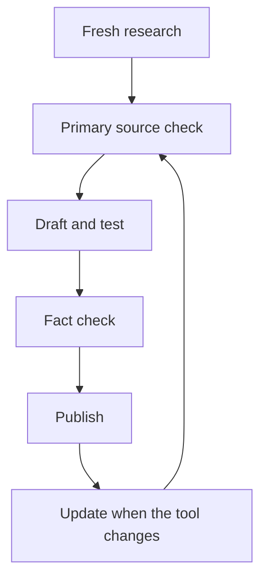

Every job in tech runs on a stack of tools, and the stack never sits still. Plans change, prices move, a feature that sold you on a product gets deprecated, and the comparison article you trusted was written two versions ago. loop and stack exists to keep up with that loop, so you do not have to.

We are an independent publication about the tools that power modern tech. We review them, compare them, explain their pricing, and write tutorials against the version you can actually download today. This page is the map: what we cover, who writes it, how an article gets made, and how we make money.

## Why another tech publication?

Because the tool layer is where the money and the hours go, and it is oddly underserved. Vendor pages are written to sell, not to inform. Roundups on big sites are often refreshed in name only, with last year's findings under this year's date. Forums know the truth but bury it in threads nobody can find twice.

Our answer is boring and strict: fewer topics, covered properly, updated when they change. Three articles every weekday, researched fresh from primary sources, so you can check our work.

## What we cover

Eight beats and six editors. Most editors cover two desks, so the person writing about a category actually lives in it.

| Beat | Editor | What you will find |
| --- | --- | --- |
| AI tools | Daniel Reyes | Assistants, writing and image tools, automation platforms, plan and pricing breakdowns |
| Developer tools | Priya Nair | Editors, terminals, CI, hosting, cloud platforms, and the tooling around shipping code |
| Security tools | Tomas Silva | VPNs, password managers, encryption, and privacy software, tested against their own claims |
| Software | Daniel Reyes | The everyday apps people work in, compared on price, limits, and fit |
| Hardware | Elena Petrova | PC components, peripherals, and upgrades, benchmarked before they are recommended |
| Networking | Elena Petrova | Routers, Wi-Fi, mesh systems, and NAS boxes, set up and measured at home |
| Mobile | Marcus Lee | Phones, Android and iOS, and the apps and settings people actually live with |
| Linux and open source | Jonas Weber | Distributions, open source apps, and self-hosting, installed and configured from scratch |

Reviews and comparisons are the core, but not the whole site. Expect tutorials that use the current interface, explainers that translate a pricing page into plain numbers, and short news pieces when a tool changes something that matters.

## How an article gets made

The process is the product. Every article, whether it is a two-tool comparison or a pricing breakdown, goes through the same loop.

A few rules inside that loop are worth knowing:

- **Primary sources first.** Official documentation, changelogs, GitHub releases, and vendor pricing pages. If a claim cannot be traced to one of those, or tested by us, it does not run.
- **Prices carry a date.** Plan prices and limits are checked on the day of publication. When they change, we update the article and its date instead of publishing a duplicate.
- **Verdicts say who should skip.** A review that recommends a tool to everyone recommends it to no one. Every review ends with who it fits and who should walk past it.
- **Corrections happen in the open.** If we get a fact wrong, we fix the article and note the change. Readers flag errors by email, and the address is on the [Contact](/contact/) page.

The full method, including how we use AI tools in the drafting process, is written up on our [Editorial Policy](/editorial-policy/) page.

## How we make money

Reading loop and stack is free. The site is funded by advertising and by affiliate commissions, which means some links earn us a percentage when a reader signs up or buys, at no extra cost to the reader.

Two commitments keep that honest. Rankings and verdicts are never for sale, and a tool with no affiliate program can and does finish first when it is the best option. Articles that contain affiliate links say so near the top. The details are on the [Affiliate Disclosure](/affiliate-disclosure/) page, and the short version is simple: if we would not recommend it to a colleague, it does not get recommended here.

## Questions readers ask

**How often do you publish?**
Three articles every weekday. Updates to existing articles happen whenever a covered tool changes its pricing or features, and they do not count toward the daily articles.

**Do vendors pay for reviews or placement?**
No. We do not accept sponsored reviews, paid placements, or review units with conditions. Vendors are welcome to flag factual errors, and we fix real ones.

**Who writes the articles?**
Six editors under editorial pen names, each on a fixed beat, listed on the [About](/about/) page. The byline on an article is the person accountable for its facts.

**Can I suggest a tool to cover?**
Yes. Email nethroes@proton.me with the tool and, if you can, the question you are trying to answer. Reader questions are a regular source of comparisons.

## Start reading

New here? The [Categories](/categories/) page shows the beats, [Tags](/tags/) gets you to a specific tool, and the [Archives](/archives/) list everything in order. Tomorrow's article is already being researched.

Welcome to the loop.
