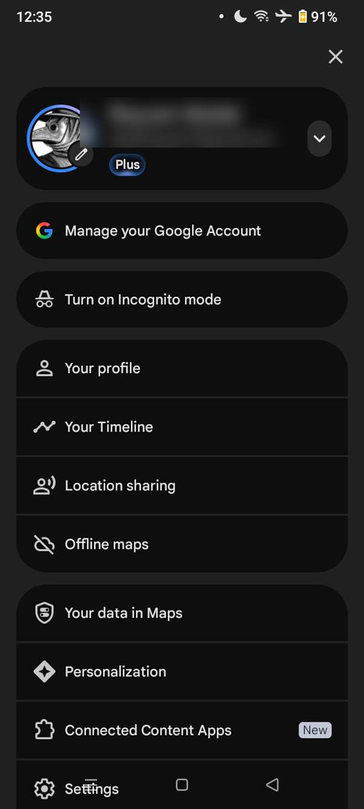
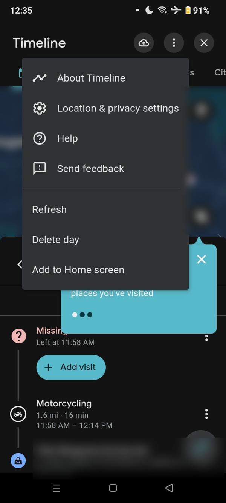
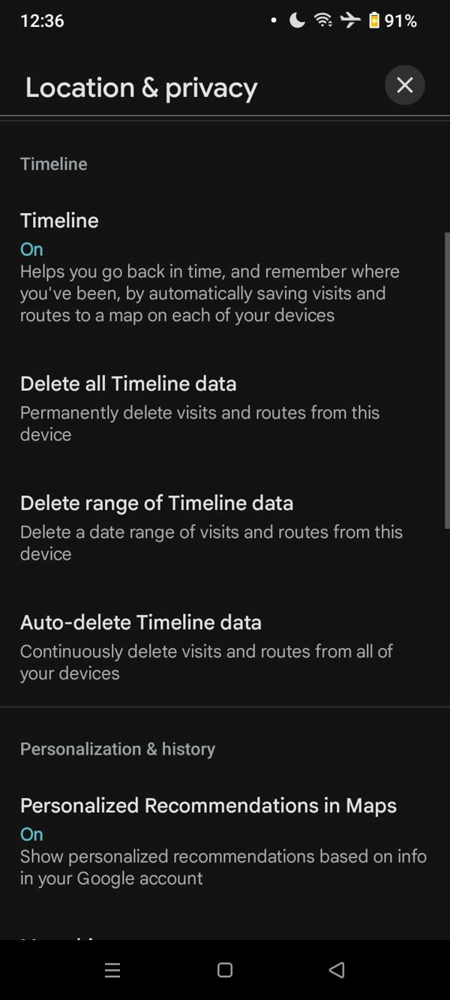
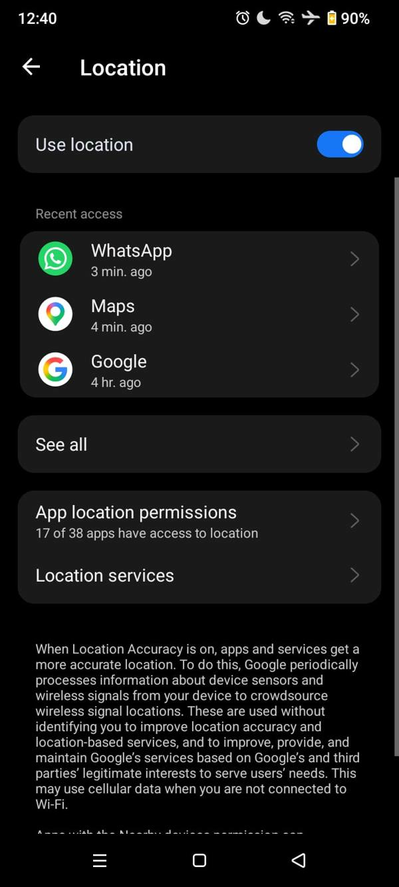
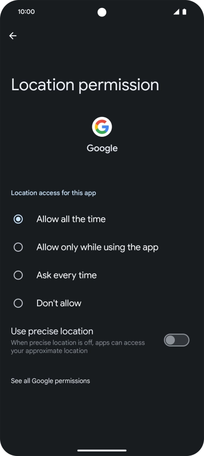

Your Android phone keeps a diary of where you go. Every visit, every route, every stop for coffee, saved day by day in Google Maps Timeline. If you turned it on at some point and forgot about it, that diary might stretch back years.

Short version: open Timeline, look at what is there, and decide what stays. Set auto-delete to 3 months so old entries clear themselves, and check which apps hold location permission while you are at it. The whole cleanup takes about ten minutes.

## How to see your Timeline

Timeline lives inside Google Maps, and it needs Maps version 11.106 or newer. It is not available on Android Go devices.

1. Open Google Maps.
2. Tap your profile picture or initial at the top right.
3. Tap **Your Timeline**.

You get a map and a day-by-day list of places you visited and routes you took. Tap any day on the calendar to see that day in detail. The tabs at the top (Places, Cities, World) give you the highlight reel if you want the big picture instead of the daily log.

One thing worth knowing before you start deleting: Timeline is off by default and only records if you opt in. If your Timeline is empty, it was never turned on, and you can skip straight to the app permissions section below.

## Delete a single day

Maybe one day is the problem. A trip you would rather not keep, or a day with a wrong location that bugs you. Deleting one day is the fastest fix.

1. Open **Your Timeline** and pick the day.
2. Tap the three-dot menu at the top right.
3. Tap **Delete day** and confirm.

That day is gone from this device. Google is blunt about this: deleted Timeline data is permanent and cannot be recovered. There is no recycle bin, so be sure before you confirm.

You can also delete a single stop instead of the whole day. Open the day, tap the three-dot menu next to one visit, and delete just that visit.

## Delete a date range, or everything

For a bigger cleanup, the Location and privacy settings page has the heavy tools.

1. Open **Your Timeline**.
2. Tap the three-dot menu, then **Location & privacy settings**.
3. Pick **Delete range of Timeline data** to wipe a stretch of dates, or **Delete all Timeline data** to start from zero.

Three catches apply here. First, the delete only covers this device. If you edit or delete Timeline data on one phone, it does not carry over to your other devices, and your backups are separate too. Second, turning Timeline off does not erase what is already saved. You have to delete it separately. Third, other Google settings can still hold location data of their own. Web and App Activity and Search Services History may include your general area and IP address even after Timeline is clean, so check those in your Google Account if you want a full sweep.

## Set auto-delete so you never have to do this again

Manual deletion is a chore you will forget. Auto-delete is the setting that makes the problem go away on its own.

1. Open **Your Timeline**.
2. Tap the three-dot menu, then **Location & privacy settings**.
3. Tap **Auto-delete Timeline data**.
4. Pick 3 months, 18 months, or 36 months.

Three months is the right pick for most people. It keeps recent history useful (finding that restaurant from last month still works) while nothing older than a season survives. [Google documents the three options on its Timeline help page](https://support.google.com/maps/answer/6258979?hl=en-CA&co=GENIE.Platform%3DAndroid).

## Turn Timeline off completely

If you would rather your phone kept no diary at all, switch Timeline off.

1. Open **Your Timeline**.
2. Tap the three-dot menu, then **Location & privacy settings**.
3. Tap **Timeline is on**.
4. Choose **Turn off**, or **Turn off and delete activity** to stop recording and wipe the history in one move.

Turning it off stops new entries. It does not touch your backups, and a factory reset or clearing Google Play services data wipes the Timeline stored on that device. If you change your mind later, Timeline stays off until you opt back in.

## Audit which apps can see your location

Timeline is only half the story. The other half is the apps on your phone, and this is where most people find surprises.

Open **Settings**, tap **Location**, and look at the **App location permissions** row. It tells you straight up how many apps have access. On the phone in the screenshot below, 17 of 38 apps had location access.

Tap **App location permissions** to see the full list, grouped by how much access each app has. Tap any app to change it. You get four choices:

- **Allow all the time.** The app can read your location in the background, even when you are not using it. Only navigation, fitness tracking, and a few similar apps have a real reason for this.
- **Allow only while using the app.** The sensible default for maps, ride hailing, delivery, and weather apps. They get your location when open and lose it when closed.
- **Ask every time.** The app has to ask on each use. Good for apps you use rarely.
- **Don't allow.** No location at all. Most apps still work fine without it.

*Screenshot: Vodafone UK device guide.*

Be strict with the first group. If an app sits under "Allowed all the time" and cannot explain why it needs your location at 3 a.m., move it down to "while using the app" and see if you notice any difference. You almost never will.

## Precise or approximate: the toggle most people miss

On the same per-app screen, look for the **Use precise location** toggle. Android 12 and newer let you hand an app an approximate location instead of an exact one.

With precise location off, the app only learns your general area, roughly a few kilometers wide. That is plenty for a weather app, a news app, or a shopping app that just wants your city. Keep precise location on only for apps that genuinely need your exact spot: navigation, ride hailing, food delivery. [Android's developer docs explain how the two accuracy levels work](https://developer.android.com/develop/sensors-and-location/location/permissions/runtime?hl=en&authuser=0).

## The two hidden toggles under Location services

Back in **Settings > Location > Location services**, there are two more switches that quietly feed location data even when Wi-Fi and Bluetooth look switched off.

- **Wi-Fi scanning** lets the phone scan for nearby networks to pin down your position.
- **Bluetooth scanning** does the same with nearby Bluetooth devices.
- **Google Location Accuracy** combines GPS with Wi-Fi networks, cell towers, and sensor data for a faster, more accurate fix. Google says it periodically processes sensor and wireless signal information to crowdsource signal locations.

Turning Wi-Fi and Bluetooth scanning off costs you some indoor and city accuracy, and maps may take longer to lock on. That is the trade. If you want location to work well, leave them on and control the apps instead. If you want the tightest setup, switch them off along with Location Accuracy and accept that navigation gets a little slower to find you.

## What this cleanup does not cover

Clearing Timeline and tightening permissions is a big step, but it is not total. Your photos may still carry GPS coordinates in their metadata, depending on your camera app settings. Your carrier always knows roughly where your phone is, and no setting changes that. And Google services can still log your general area through your IP address and search activity. Privacy on a phone is layers, not one switch, but Timeline and app permissions are the two layers that matter most, and now both are under your control.

## Bottom line

Open Timeline today and look at it once. Most people are surprised by how much is in there. Delete what you do not want, set auto-delete to 3 months, then spend two minutes demoting apps from "all the time" to "while using the app" and switching the rest to approximate location. Ten minutes now, and your phone stops keeping a diary you never asked to write.

## Keep reading

- [ChatGPT vs Claude: Which $20 Plan Is Worth It?](/posts/chatgpt-vs-claude-which-20-plan-is-worth-it/)
- [Welcome to loop and stack](/posts/welcome-to-loop-and-stack/)
