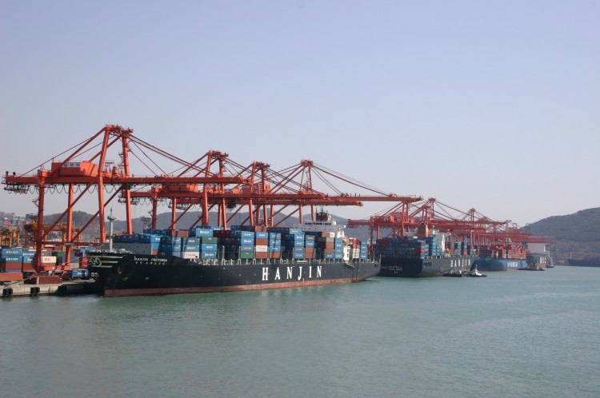

*Image: Docker*

Docker has a new look. On November 19, the company unveiled a redesigned brand: a simplified Moby the whale, a deeper violet-blue, and a new slogan, "Run on Trust." Docker Desktop 4.100.0 shipped the same day wearing the new identity.

Short version: this is a rebrand with a strategy behind it, not a new product. Your containers, your Dockerfiles, and your `docker compose up` all work exactly as before. What changed is what Docker says it is for: not just running apps in containers, but running AI agents you can actually trust. If you only use Docker to run containers, update and move on. If you let AI agents touch your code, the new direction matters more.

## What changed on November 19

Docker launched the new brand in a post called ["Meet the New Docker: Built to Run on Trust."](https://www.docker.com/blog/meet-the-new-docker-built-to-run-on-trust/) The whale got a makeover first. Moby, the mascot the community named back in 2013 after Moby-Dick, is now a simplified black whale with no containers stacked on its back. The brand agency Motto helped design it. The familiar bright Docker blue is gone too, replaced by a deeper violet blue across the logo, the website, and the app.

The words changed more than the pictures. Docker's message now rests on three pillars: a trusted supply chain for what agents build from, a trusted runtime to isolate agents while they run, and a trusted ecosystem that ties the layers together. The company also promises no vendor lock-in, which is a pointed thing to say when every AI vendor right now wants you locked into their stack.

Two products sit at the center of that pitch. Docker Sandboxes give agents an isolated place to run, and Docker AI Governance adds the controls around them. Both get name-checked in the announcement as the practical version of the trust story.

## Old Docker vs new Docker

|  | Old Docker | New Docker |
| --- | --- | --- |
| Logo | Whale carrying containers | Simplified whale, no containers |
| Signature color | Bright Docker blue | Deeper violet blue |
| Slogan | Build, Ship, Run | Run on Trust |
| Focus | Running apps in containers | Trusted execution for apps and AI agents |
| Audience | Developers | Developers, enterprises, and AI builders |

The table makes it look like a bigger break than it is. Docker is careful to say the container business is not going anywhere, and that makes sense. Containers are still the thing millions of developers open every day. The rebrand adds a second job on top of the first one.

## Why agents, why now

Docker's own explanation is the most honest part of the announcement: "Containers isolate workloads. But agents are not workloads. Agents are actors."

A container runs the code you gave it. An agent decides what to run, what to access, and what to change, and it does that on its own. That is a different problem, and a container alone does not solve it. You need isolation plus governance: limits on what the agent can reach, a record of what it did, and a way to stop it. That is the gap Docker wants to own, and the whole rebrand is built to say so.

Skeptics will call this a marketing pivot, and they are not entirely wrong. Trust is a word every vendor leans on when a new technology makes people nervous. The test is whether the products behind the slogan hold up. Sandboxes and AI Governance are real products, not just a new coat of paint, so the rebrand has something to stand on. But if you never run an agent, none of that changes your day.

## Docker Desktop 4.100.0: what you actually get

The new brand arrives in a real release, [Docker Desktop 4.100.0](https://docs.docker.com/desktop/release-notes/), dated November 19. The headline change is the refreshed look and the updated Moby logo. Underneath it, the release bundles Docker Offload v0.7.47, Docker Hardened Images (dhictl) v0.0.12, Docker Agent v1.156.2, and Docker Compose v5.7.1.

The bug fixes are the part most people will feel. A restart no longer risks losing Kubernetes state for kind clusters running under Enhanced Container Isolation. Docker Desktop stops re-downloading an update it already downloaded. A nasty hang that could grow memory use to several gigabytes when publishing host port 65535 is fixed. The MCP Toolkit Profiles tab no longer fails to load when a profile has many servers configured, and chunked `docker build` API requests stop hanging over keep-alive connections.

Windows users get two changes worth knowing. The WSL 2 engine now uses single-distro mode by default and migrates older dual-distro setups automatically on the next start, which Docker says improves performance. New Docker VMM installations also get a sparse raw disk format, DockerDesktop.raw, replacing VHDX to prevent meta.db corruption. Existing installations are unaffected, so this one only matters if you install fresh.

Rollouts are gradual, so 4.100.0 may not be offered to you the moment you read this. Docker says updates typically reach everyone within a week of the release date. When the prompt appears, take it. There is nothing in this release that asks you to change how you work.

## What did not change

{: width="650" }

*Container ships at Busan. Photo: zol87 via Wikimedia Commons (CC BY-SA 4.0).*

Nothing in the announcement touches pricing, plans, or the free tier. Your images, your registries, and your Compose files are untouched. Docker Hub works the same way. The commands you type every day are the same commands, and the whale on your taskbar just looks a little different.

That is the honest answer to the question in the title. The rename is real, the strategy behind it is real, and your workflow is the same as it was on November 18. Docker wants to be the company you trust with agents, and it redesigned itself to say so. Whether you buy that story depends on what you do with agents, not on the logo.

## Bottom line

Update to Docker Desktop 4.100.0 when it reaches you, enjoy the handful of bug fixes, and keep shipping containers the way you already do. If you run AI coding agents, take a look at Sandboxes and AI Governance, because that is where Docker is actually heading. Everyone else can file the new whale under nice to know and get back to work.

Keep reading: if AI tools are already part of your daily workflow, our [ChatGPT vs Claude: Which $20 Plan Is Worth It?](/posts/chatgpt-vs-claude-which-20-plan-is-worth-it/) breaks down what your money buys. And if you want to see what your phone knows about you, [Your Android Phone Is Tracking Everywhere You Go](/posts/your-android-phone-is-tracking-everywhere-you-go/) walks through Google Maps Timeline.
