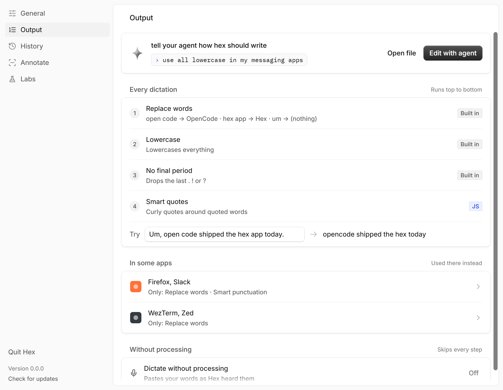
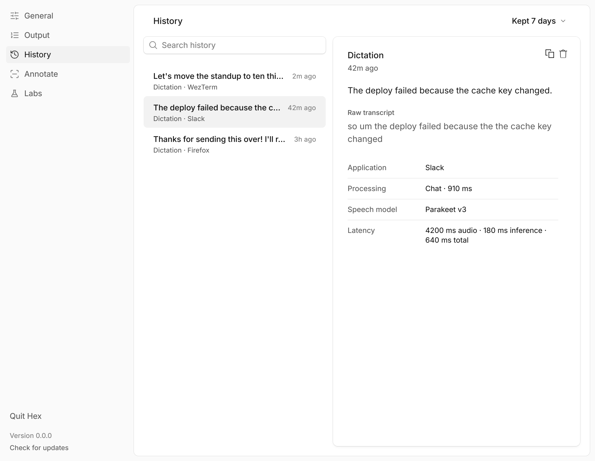

Most dictation apps have a deal you never really agreed to: your voice goes to someone else's server, gets transcribed there, and comes back as text. [Hex](https://anoma.ly/hex) refuses that deal. It is a free, open source dictation app from Anomaly, the team behind OpenCode, and it transcribes everything on your own machine. Hold a key, speak, let go, and the text lands at your cursor.

Short version: if you dictate on a Mac and you care where your voice goes, Hex is the easiest yes in this category. It costs nothing, the code is MIT licensed, and the privacy story checks out against the docs, with one honest exception worth knowing before you turn everything on. Windows and Linux users get a beta, and Intel Mac owners are out of luck entirely.

## How it works

The whole interaction is one gesture. Hold the shortcut key, say what you mean, release it, and Hex pastes the transcript into whatever app is in front of you: a terminal, an editor, a chat box, an AI agent prompt. There is no dictation window to manage and no cloud round trip to wait for. If holding a key gets old, a Tap mode starts and stops dictation with a press instead, and Option-Shift-V pastes your last dictation again (Ctrl-Alt-V on Windows and Linux).

{: width="350" }

*Hex's mascot on the official site. The blob is a still from the site's animated hero.*

The first run downloads a speech model, which is the one moment Hex needs the network for its core job. After that, transcription runs on-device. On an English system the default is Parakeet Unified English, which transcribes while you talk, so the text is ready the moment you release the key.

## Setup: quick on a Mac, beta elsewhere

Hex is Mac-first. You need Apple silicon and macOS 15 or later, and there is no Intel build. Grab the signed DMG from the [official site](https://anoma.ly/hex) or install it with Homebrew (`brew install --cask anomalyco/tap/hex`). macOS will ask for Microphone and Accessibility access, which is expected: Hex has to hear you and paste where your cursor is.

Windows (x64 and ARM64) and Linux (x86_64 and ARM64, with .deb and .rpm packages) are both in beta, installable from the same site or, on Linux, with an install script, the AUR (`yay -S hex-bin`), or Nix. The project was created in July 2026 and already has more than 7,700 stars on [GitHub](https://github.com/anomalyco/hex), which tells you how many people were waiting for exactly this.

## The output pipeline is the real product

Transcription is only half of Hex. The interesting part is what happens to the text before it gets pasted. Every dictation runs through a pipeline of steps you choose: word replacements, built-in cleanups, your own scripts, and an optional OpenCode rewrite. Different steps can apply per app or website, so Hex can write one way in Slack and another way in your terminal.

{: width="350" }

*Hex's Output screen: every dictation runs through your steps, top to bottom, with different steps per app. Screenshot: Anomaly.*

The built-in steps cover the small embarrassments of raw dictation. Replace words turns "open code" into "OpenCode" and "hex app" into "Hex" every time, Lowercase forces everything down, No final period drops the trailing punctuation, and Smart quotes curls the quotes. A Try box at the bottom lets you test the whole chain on a sentence before you commit to it: type "Um, open code shipped the hex app today." and watch the ums and the casing disappear.

Vocabulary is one list of names and terms Hex should know. Whisper and Qwen3-ASR read it while transcribing; Parakeet models need Labs › Vocabulary help switched on. That list also feeds the OpenCode rewrite, which matters for the privacy caveat below.

## Models: pick your transcriber

The settings picker offers a serious bench of speech models, and you can add your own GGUF model with "Add model file…" if none of them fits. The headline options:

- Parakeet v3: 25 European languages, and it hears which one you are speaking
- Cohere Transcribe: the fewest wrong words, in 14 languages, but a big download
- Whisper large-v3-turbo: almost any language, and it reads your vocabulary
- Qwen3-ASR 0.6B: Chinese and 29 more languages, and it reads your vocabulary
- SenseVoice Small: Chinese, Japanese, Korean, and English, in a small download
- Nemotron 3.5 ASR: writes while you talk, in 27 languages
- Granite Speech 5.0: IBM's model, seven languages, with punctuation

Single-language models cover Hebrew, Russian, Norwegian, Swedish, and Egyptian Arabic, and the default model also serves meetings and the command line tool.

## History and privacy: the part that earns the name

Hex keeps past dictations searchable for 7 days by default, capped at 10,000 entries and 16 MB. No dictation audio is saved by default, and history never stores audio, full browser URLs, or window titles. Turn it off entirely with History › Keep: Off.

{: width="350" }

*Hex's History screen: past dictations with a search field, and one entry's raw transcript, app, processing, and model. Screenshot: Anomaly.*

Each entry shows the raw transcript next to the cleaned text, the app it went to, the processing steps that ran, the speech model, and the latency. You can see exactly what Hex heard and what it changed.

Now the caveat, stated plainly because the project states it plainly. Ordinary dictation sends nothing anywhere. But the optional OpenCode rewrite is a cloud feature: if you enable it, Hex sends the transcript, the foreground application, and the Brave website hostname to the model provider you configured. The same goes for the optional Voice Action feature, which sends your instruction and selected text too. Both are off by default and live in separate settings from dictation itself, so you can use Hex for years and never touch the network beyond model downloads and updates.

## A command line and a few extras

`hex transcribe meeting.m4a` prints a recording's transcript whether or not the app is running, reading WAV, AIFF, CAF, FLAC, MP3, Ogg, WebM, and MP4/M4A/MOV, including a video's soundtrack. The same `hex` command controls the running app with `hex status`, `hex dictation`, and `hex settings`. An authenticated local API and a TypeScript SDK expose the same model to your own tools.

Labs, at the bottom of the sidebar, holds the experiments: Annotate records the screen while you draw and talk, and Meetings, a macOS lab, records a call and writes the transcript.

## The limits

Hex is not for everyone yet. The Mac build needs Apple silicon and macOS 15, so Intel Macs are simply excluded. Windows and Linux are beta, which means rough edges and faster change. iOS exists only as an internal beta, so do not expect a mobile app. And the project does not accept pull requests, so if you want something fixed, you open an issue and the team's agents usually turn it around fast.

## Verdict

Hex does one thing, dictation without the cloud, and does it with unusual care. The output pipeline is the reason to stay after the privacy pitch wins you over: per-app steps, a vocabulary list, and a Try box make dictated text usable instead of merely transcribed.

Get it if you dictate on an Apple silicon Mac and you would rather your voice never left the room. Try the beta if you are on Windows or Linux and you like where this is going. Skip it if you are on an Intel Mac, or if you need a mobile dictation app today.

**Pros:** fully local transcription; free and MIT licensed; per-app output pipeline with a Try box; strong model picker plus your own GGUF models; honest history with raw transcripts; useful CLI and SDK.

**Cons:** Apple silicon and macOS 15 only on Mac; Windows and Linux still beta; no mobile app yet; the OpenCode rewrite is a cloud feature hiding inside a local app; no pull requests accepted.

## Frequently asked questions

**Does Hex need the internet to dictate?**
No. After the first-run model download, transcription runs on-device; only model downloads, updates, and the optional OpenCode rewrite touch the network.

**Which platforms does Hex support?**
macOS on Apple silicon (macOS 15+), with Windows and Linux in beta; there is no Intel Mac build.

**Is Hex free?**
Yes, free and MIT licensed, with no paid plan.

**What leaves my machine when I dictate?**
Nothing in ordinary dictation. The optional OpenCode rewrite sends the transcript, foreground app, and Brave hostname to your configured model provider.

Keep reading: if AI tools are already part of your daily workflow, our [ChatGPT vs Claude: Which $20 Plan Is Worth It?](/posts/chatgpt-vs-claude-which-20-plan-is-worth-it/) breaks down what your money buys. And if you want to see what your phone knows about you, [Your Android Phone Is Tracking Everywhere You Go](/posts/your-android-phone-is-tracking-everywhere-you-go/) walks through Google Maps Timeline.
