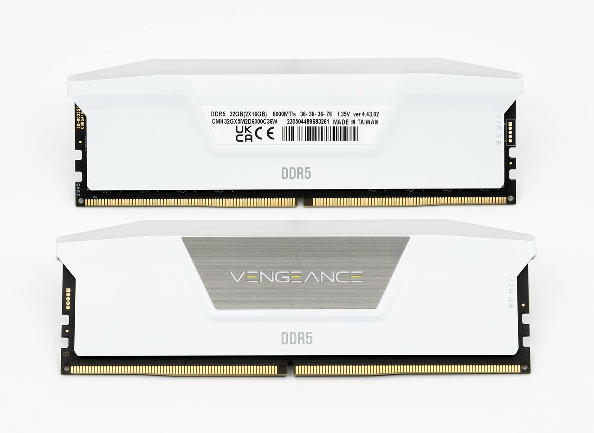
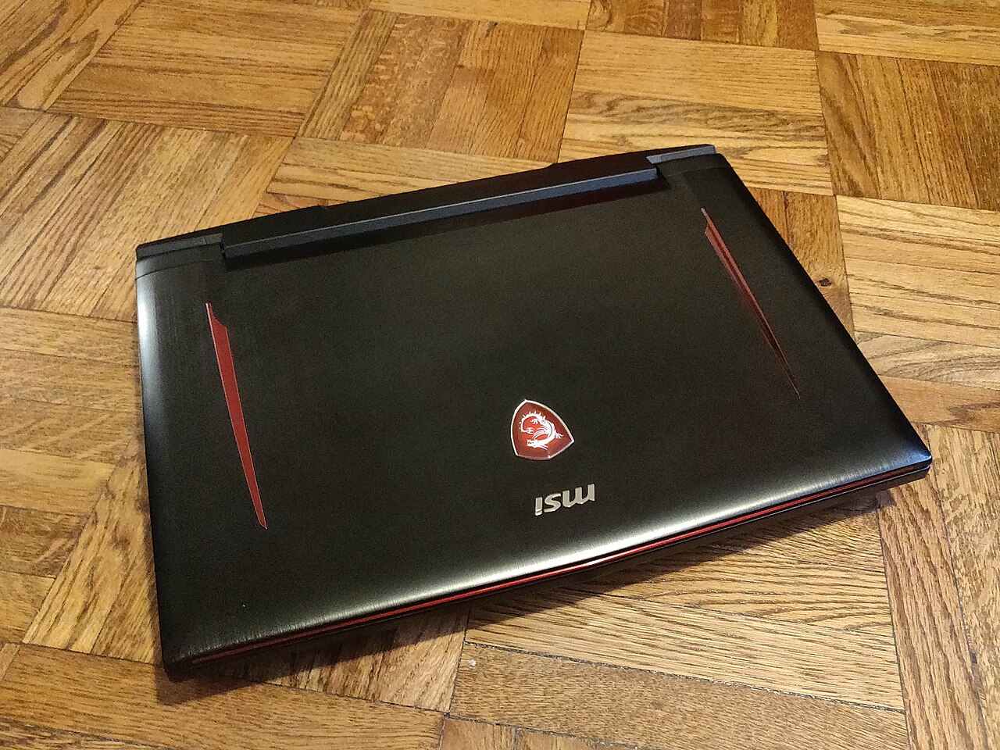

Black Friday is tomorrow, November 27. If you have been waiting all year to buy a graphics card or a RAM upgrade, here is the honest answer: the deals are not coming, and waiting is probably costing you money.

That is not the usual pre-sale pessimism. The numbers say it plainly. The RTX 5080 launched at $999 in January 2025. The cheapest in-stock card in the US was about $2,000 in early November, and some retailers were asking $2,200 or more. A 32GB DDR5 kit that bottomed out at $72 now starts around $459, and some kits have pushed past $550. This is not a sale waiting to happen. It is a shortage, and sales do not fix shortages.

## The damage, in one table

Prices checked November 25 to 26, 2026. Street prices move daily, so treat these as a snapshot, not a quote.

| Part | Launch price or all-time low | Street price now | The gap |
| --- | --- | --- | --- |
| RTX 5090 | $1,999 | $6,200 to $9,400 | 3x to 4.7x |
| RTX 5080 | $999 | $1,999 to $2,200 | About 2x |
| RTX 5070 Ti | $749 | About $1,250 | 67% over |
| RX 9070 XT | $599 | About $870 | 45% over |
| DDR5-6000 32GB kit | $72 | $459 to $570 | 6x to 8x |
| DDR5-6000 64GB kit | $159 | $989 to $1,118 | 6x to 7x |

Two things stand out. First, every card on the list costs more than its launch price, and the flagship costs more than triple. Across 21 tracked GPUs, new prices [averaged 65 percent above launch MSRP](https://www.videocardprices.com/gpu-price-index/) as of November 25. Second, the cheapest card in the table is not really cheap. The RX 9070 XT at $870 is the least inflated current card, and it is still 45 percent over its launch price.

{: width="350" }

*Corsair Vengeance DDR5 modules. A 32GB kit like this cost $72 at its low; today it starts around $459. (Photo: Jacek Halicki, CC BY-SA 4.0, via Wikimedia Commons)*

## Why memory is the villain

The shortage is not about graphics chips. It is about the memory on them, and the memory in everything else.

AI data centers are buying DRAM faster than the factories can make it. The memory inside an AI server and the memory inside your PC come off the same wafers, and the data centers buy first, in bulk, on multi-year contracts. High-bandwidth memory, the stacked DRAM that feeds AI accelerators, eats roughly three times the wafer capacity per gigabyte that ordinary DDR5 does. Every wafer committed to HBM is a wafer that never becomes a stick of RAM.

The numbers behind that are stark. A 16Gb DDR5 chip that cost about $8.70 in October 2025 was running near $48 by September 2026, a rise of more than 450 percent. TrendForce, which tracks the contract prices big buyers pay, recorded conventional DRAM contract prices rising 93 to 98 percent in the first quarter of 2026 alone, and it expects another 10 to 15 percent in the fourth quarter. J.P. Morgan has estimated DRAM prices will have risen more than 400 percent from the start of 2024 to the end of 2026.

Three companies, Samsung, SK hynix, and Micron, sell close to nine out of every ten dollars of DRAM in the world. When all three would rather sell to a hyperscaler than to a PC builder, there is no second source to shop around. SK hynix told investors in October that its DRAM, NAND, and HBM capacity is essentially sold out for all of 2026.

How long does it last? [Team Group's CEO told investors](https://tech-insider.org/team-group-ddr5-chip-price-452-percent-shortage-2028-2026/) the worst stretch of the DDR5 shortage runs through the second quarter of 2027 and that supply and demand may not balance until the second half of 2028 at the earliest. Take that with a grain of salt, he sells memory, and scarcity is good for his margins, but the forecasters who give a date mostly agree with him. Nobody credible expects relief in 2027.

## Even a CEO resignation could not move GPU prices

If you want proof that nothing short of more supply will fix this, look at Nvidia's month. Founder and CEO Jensen Huang resigned on November 12 after a scandal that wiped trillions off the company's market value in days. Nvidia's stock plunged more than 13 percent after the news broke. The graphics cards did not flinch. The cheapest RTX 5080 stayed around $2,000. The 5090 stayed somewhere between $6,000 and $9,000, depending on which tracker you believe.

That is the whole story in one week. The stock market can panic. The GPU market cannot, because there is nothing to panic about from the seller's side. Every card sells. Retailers have no reason to discount, and this Black Friday they have even less room than usual: they are holding RTX 50-series stock bought at wholesale prices that Nvidia's board partners raised again in November.

History backs this up. [Tom's Hardware found no real GPU deals over the 2023 Black Friday weekend](https://www.engadget.com/2318262/nvidia-gou-dont-get-deep-discounts-black-friend-ceo-scandal/), and in 2024 the RTX 4090 was selling above $2,000 against a $1,599 launch price. Black Friday discounts the things retailers want to clear. Nobody needs to clear a GPU right now.

## What to buy instead

Waiting is a bad plan, but panic buying at twice the launch price is worse. The trick this year is to buy the categories the shortage has not fully reached.

**A complete PC, not parts.** System builders buy memory and graphics cards under long contracts, so a finished desktop or laptop can cost less than the same parts bought separately at today's street prices. Lenovo's Black Friday lineup, [checked November 25](https://fateka.com/blog/black-friday-2026-what-to-buy-and-skip/), includes a Legion Tower 5i with an RTX 5070 Ti and 32GB of DDR5 for $2,449.99, and a Legion 5a gaming laptop with an RTX 5060 for $1,249.99. Do the math on the parts before you dismiss a prebuilt as a bad deal; this year the math often flips. One rule: skip any machine with only 8GB of memory. That is a doorbuster trap, not a deal.

{: width="350" }

*A complete gaming laptop can cost less than the same parts bought separately right now, because system builders buy memory under long contracts.*

**An SSD, if you need storage.** SSDs are the one category with real downward pressure behind them. NAND flash contract prices were flat in October, ending a rally that began in January 2025, and TrendForce has said prices could decline in the fourth quarter. If your upgrade is storage, Cyber Monday is worth watching.

**A less inflated card, or a used one.** If you need a GPU this week, the RX 9070 XT at about $870 is the least inflated current card, and the RTX 5070 Ti at about $1,250 is the cheapest way into 16GB of VRAM with CUDA. For local AI work, a used RTX 3090 with 24GB of VRAM [averaged around $1,460 on eBay US in September](https://aifoundationtools.com/black-friday-gpu-2026/), which buys you more memory per dollar than anything new. Check the seller, the card's history, and the return policy before you pay.

**Wait for Cyber Monday on laptops, not parts.** Adobe forecasts the deepest computer discounts landing on Cyber Monday, November 30, at around 23 percent off list price. That applies to complete computers, not to graphics cards or RAM kits. Set your alerts for systems, not components.

## What to skip

Skip the RTX 5080 at $2,000. It is a $999 card, and at twice that price it costs more than the RTX 5090 did at launch. Skip bare DDR5 kits unless your machine genuinely cannot run without more memory; paying $459 for a kit that cost $72 is a tax on impatience, and if your current 16GB still gets the job done, it will still get the job done in January. Skip any Black Friday GPU listing with a struck-through "was" price that is higher than the card's launch price. That is not a discount. That is a confession.

## The bottom line

Black Friday assumes retailers have margin to give away. This year the memory market took the margin first. A 32GB RAM kit costs six times its low, the RTX 5080 costs twice its launch price, and the people who make the memory say supply will not balance until the second half of 2028. No sale fixes that.

So do not wait for Friday to save you. Buy the complete system if you need a machine, buy the SSD if you need storage, and buy the RAM or the GPU only if you need it now and the price is one you can live with. Everything else can wait, and waiting is the one thing that is still free.

## Frequently asked questions

**Will GPU prices drop on Black Friday 2026?**

No, not in any meaningful way. Black Friday has almost never produced real GPU discounts, and this year retailers are holding stock bought at wholesale prices that rose again in November. The cheapest RTX 5080 in the US was about $2,000 in early November, double its $999 launch price, and nothing in the market points down.

**When will RAM prices come back down?**

Not soon. Team Group's CEO told investors the worst of the DDR5 shortage runs through the second quarter of 2027 and supply may not balance until the second half of 2028 at the earliest. TrendForce expects DRAM contract prices to rise another 10 to 15 percent in the fourth quarter of 2026.

**Is a prebuilt PC cheaper than buying parts right now?**

Often, yes. System builders buy memory and GPUs under long contracts, so a complete desktop or laptop can cost less than the same parts bought separately at today's street prices. Check the RAM and SSD specs before you buy, and skip any machine with only 8GB of memory.

**Is the RTX 5080 worth $2,000?**

No. It launched at $999 in January 2025, and at twice that price it costs more than the RTX 5090 did at launch. If you need a card now, a less inflated mid-range card or a carefully checked used RTX 3090 is a saner spend.
