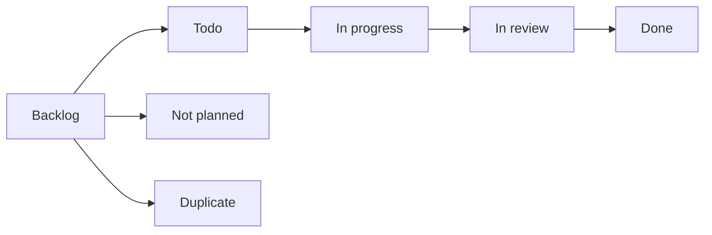

For years, a GitHub issue had two states: open and closed. Everything in between, the actual work, lived in labels. Labels only worked if someone remembered to update them, and nobody remembered. A board full of "in progress" labels from three sprints ago was not a workflow, it was archaeology.

On November 23, GitHub shipped the fix in [public preview](https://github.blog/changelog/2026-11-23-issue-statuses-and-repository-boards-are-in-public-preview/): issues now carry one of seven statuses, the status moves on its own when the work moves, and your repo gets a board to show it all. If your team already lives in GitHub Issues, this is the most useful change to the tracker in years. The board is the part you will notice first. The automations are the part that will still matter in six months.

## The seven statuses

There are exactly seven, and you cannot add your own. That will annoy teams with a beloved 14-stage workflow, and honestly, good. A status list only works when everyone means the same thing by each word.

| Status | What it means |
|---|---|
| Backlog | Parked, not scheduled yet |
| Todo | Ready to pick up |
| In progress | Someone is working on it |
| In review | A pull request is waiting for review |
| Done | Finished |
| Not planned | The team decided against it |
| Duplicate | Already tracked in another issue |

You pick a status when you create an issue, or change it from the issue header later. It shows up in the issue icon across the repository issues page, the issues dashboard, and repository boards, and you can filter on it with `status:`, as in `status:"In progress"`. Two of the seven do quiet, useful work: Not planned and Duplicate finally give you a place to put the issues you are closing without pretending they were completed.

## The automations are the actual feature

A status you have to update by hand is a label with better branding. GitHub knows this, so the statuses update themselves when the work changes:

| When this happens | The issue moves to |
|---|---|
| You link a draft pull request | In progress |
| You mark that draft Ready for review | In review |
| You link an open pull request | In review |
| You assign a person | Todo |
| You assign an agent | In progress |
| A matching status changes in a GitHub Project | Synced both ways |

Read that table again, especially the agent row. Assign an agent and the issue flips to In progress by itself. That is the detail that gives the game away. These statuses are built for a world where the assignee is sometimes an agent, not a person. Agents can read and set statuses through the GraphQL API, the REST API, and GitHub's MCP server, and a status change can trigger a Copilot automation. The status is shared context between you and the agent, not a comment thread the agent has to parse. Your standup board and your agent's to-do list are finally the same list.

## How to set up a board in your repo

This takes about a minute, and it lives inside the repo, not in a separate Project you have to remember to open.

1. Open your repository and go to the **Issues** tab.
2. Create a new saved view, or open one you already have.
3. Open **View options**, the gear menu, and switch the layout to **board**.
4. Group by status. Each status becomes a column.
5. Drag a card into another column to change that issue's status. Columns, swimlanes, visible fields, and sorting are all configurable from the same menu.

{: width="650" }

When you need more advanced planning, GitHub still points you at Projects: cross-repo views, custom fields at scale, that sort of thing. For one repo, the board inside the repo is now enough, and that is the point. The separate Project was overhead for small teams, and overhead is what kills process adoption. A board nobody opens is worse than no board at all.

## The Active filter is the quiet upgrade

Open used to mean everything that was not closed, including the backlog graveyard. Now there is an [Active](https://docs.github.com/en/issues/tracking-your-work-with-issues/using-issues/filtering-and-searching-issues-and-pull-requests#building-advanced-filters-for-issues) tab next to Open and Closed, and it counts only Todo, In progress, and In review as active. Backlog issues, open issues with no status, and closed issues sit outside it. It is a small change with an outsized effect: "what are we actually working on right now" finally has a one-click answer instead of a filter query you have to remember.

The search bar got the same treatment. `status:"In progress"` finds issues by status, `category:started` covers the in-flight set, and you can still filter by close reason, such as `reason:completed` or `reason:"not planned"`, when you want to audit what got finished versus what got deliberately dropped.

## What it doesn't do yet

Keep your expectations honest, because this is a preview.

The seven statuses are fixed, so if your team tracks "blocked on design" or "waiting for QA" as separate states, those still live in labels or fields for now. Status also sits on top of open and closed rather than replacing them. The docs treat the two layers separately, and the Active filter covers Todo, In progress, and In review only.

One related change is easy to miss. Issue fields used to require mapping to an issue type before they could appear on an issue, with Priority as the lone exception. Now you can add any field to any issue through the cog menu in the issue sidebar, regardless of type. Fields still only show by default if they have been pinned to a type, so check your defaults before wondering where a field went.

And the usual preview caveat applies: GitHub says statuses are subject to change, and it has opened a community discussion for feedback. Do not delete your label automations this week. Run the new statuses alongside them on one repo, see which one your team actually maintains, and then decide.

## Frequently asked questions

**What are the seven GitHub issue statuses?**
Backlog, Todo, In progress, In review, Done, Not planned, and Duplicate. They are a fixed set in the public preview, and you pick one when creating an issue or change it from the issue header.

**Do issue statuses replace open and closed?**
No. Open and closed still exist as the issue state. Status is a separate workflow layer on top, so an issue can be open with a Backlog status, and closing still works the way it always did.

**Can I build a kanban board without a GitHub Project now?**
For a single repository, yes. Saved views in a repo now support a board layout grouped by status, with drag and drop to change status. GitHub still recommends Projects when you need planning across repos or more advanced features.

**Do my old labels still work?**
Yes. Labels are untouched. Statuses sit alongside them, so existing label workflows and automations keep working while you try the new system.

The verdict is simple. If your repo already runs on GitHub Issues, turn this on for one repo this week and let the automations do the updating your team never did. The board will look after itself. That was always the promise of the tracker; it just took GitHub until now to build it.
