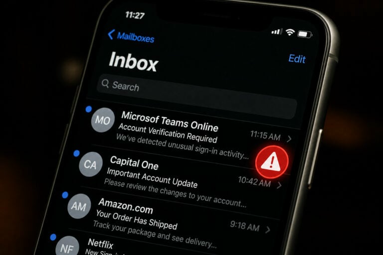

A password manager getting hacked is the nightmare scenario. It is the one breach that is supposed to end the argument about whether to trust these apps at all. So when 1Password disclosed this week that an attacker got into its backend systems and walked out with customer data, I braced for the worst version of that story.

It did not happen. Your passwords are safe, and I am not saying that because 1Password asked me to. I am saying it because of how the breach actually played out: the attacker got in, grabbed what was reachable, and still could not touch a single vault. That is the whole point of this article, and it is also the most interesting thing about the incident. This was the worst case happening in real life, and the design held.

## How the attacker got in

On November 19, 1Password started investigating signs that an attacker had access to an employee's corporate GitHub account. That account was the way in. The attacker used it to reach the company's private source code, then pushed malicious code into 1Password's backend services. Once the code was running inside, it downloaded administrative records about customers.

Read that again, because the chain matters. Nobody broke the encryption. Nobody guessed a master password. The attacker compromised one employee's GitHub login and used the trust that account carried inside 1Password's own systems. It is the same shape as most modern breaches: the front door held, so the attacker came through a side entrance that an employee left open.

The company disclosed all of this on November 25, six days after the investigation began. It also said the attacker copied source code from private repositories and got into its continuous integration and delivery system, the pipeline that builds and ships the product. That part sounds alarming, and it is, but 1Password says the source code contains no user secrets, and it has rotated or revoked every internal credential that may have been exposed in the CI/CD environment.

## What was taken, and what was not

Here is the split that decides whether you need to worry.

| Taken | Not taken |
|---|---|
| Names and email addresses | Vaults and everything in them |
| Account and user IDs | The keys that protect your vaults |
| Account creation and last sign-in times | Your account password |
| Public keys | Your Secret Key |
| Secure Remote Password protocol parameters | Account recovery keys |
| Tokens from invitation, provisioning, and recovery emails | 1Password apps and browser extensions |
| Non-secret internal metadata | |

The right column is the one that matters, and it stayed intact for a reason that has nothing to do with luck. 1Password is built so that your vault is encrypted with keys only you hold. The company does not store your account password or your Secret Key, and it cannot decrypt your vault even if it wanted to. An attacker standing inside its servers is in the same position: surrounded by encrypted vaults with no keys.

I have written before about encryption that protects data even when the hardware is stolen, in the piece on [BitLocker's TPM-only default](/posts/bitlockers-tpm-only-default-is-the-weak-link-add-a-preboot-pin/). This is the same idea at cloud scale. The protection does not live in a firewall or a login page. It lives in the fact that the secret never leaves your device in a usable form.

The left column still stings, though. Names and email addresses are the raw material of phishing, and the attacker now knows exactly who uses 1Password. The invitation and recovery tokens sound worse than they are: 1Password says a token on its own cannot open an account, because using one also requires either a single sign-on login or a verification code sent to your registered email. As a precaution the company lengthened those codes from six digits to ten alphanumeric characters, which makes guessing one practically impossible. Only a small number of users were in a state where those tokens applied, and 1Password says it notified them directly.

## The honest asterisk

Two things are still unknown, and I would rather name them than smooth them over.

First, 1Password has not said how many customers were affected. "A subset" is the whole answer so far. That could mean hundreds or hundreds of thousands, and the difference matters for how much phishing is coming. Second, the full root cause analysis is still weeks away. The company has brought in independent cybersecurity experts to validate its containment and cleanup, and it says it has found no evidence of any account takeovers using the stolen data. Both of those are reassuring, but both are also the company's own word for now. The disclosure is detailed and specific, which counts for something. Vague breach notices are usually the ones hiding a worse story.

There is also a fair question about how an employee's GitHub account became the key to the kingdom in the first place. 1Password says it has tightened its GitHub, CI/CD, and endpoint controls and added new detections for this kind of attack. That is the right response, and it is also an admission that the controls were not tight enough before. A password manager company getting in through a compromised developer account is embarrassing in a way that no amount of good encryption erases. The encryption saved the customers. The access controls failed the company.

## The risk moved to your inbox

{: width="350" }
*Hands on a keyboard, password field on screen (Photo: Cyber-Sécurité)*

If you use 1Password, 1Password says you do not need to do anything. No password change, no rotation, no re-enrollment. I agree with that, with one addition: expect phishing, and treat the next few weeks as open season.

The attacker has your name, your email, and the knowledge that you trust 1Password enough to pay for it. That is everything a scammer needs to write a message that looks like it came from 1Password support, warning you about this very breach and asking you to "verify" your account. The irony is the bait. A real warning about the breach becomes the perfect cover for a fake one.

{: width="350" }
*A scam email hiding in plain sight in an inbox (Photo: GeekExtreme)*

So the rules, short version: 1Password will never contact you to ask for your account password or Secret Key. Only enter them in the official app, or on the official site after you typed the address yourself. Never through a link in an email, a text, or a phone call, no matter how urgent it sounds. Your Secret Key is only needed the first time you sign in on a new device or browser, which makes any unexpected request for it an immediate red flag. If something looks off, forward it to support@1password.com.

## My take

I have spent years telling people to use a password manager, and breaches like this one are exactly what skeptics point at when they say the whole idea is a single point of failure. They are half right. Centralizing your passwords does create a target. But this incident is the strongest evidence yet for the other half of the argument: when the target gets hit, the design decides what the attacker leaves with. A password manager that stores your vaults in a form even it cannot read is not a single point of failure. It is a vault with the key in your pocket and the building on fire around it.

That does not let 1Password off the hook. An employee account should never have been enough to push code into backend services, and I will be reading the root cause analysis when it lands to see how that happened. But if you were waiting for a reason to quit your password manager, this is not it. This is the reason to keep using one, and to keep your Secret Key somewhere the internet cannot reach.

## Frequently asked questions

**Was my 1Password vault accessed in the breach?**

No. 1Password says vault contents were at no point accessed by or available to the attacker. Your vaults are encrypted with keys only you hold, and 1Password does not store your account password or Secret Key.

**What data did the attacker actually steal?**

Account records for a subset of customers: names, email addresses, account and user IDs, account creation and last sign-in times, public keys, Secure Remote Password protocol parameters, and tokens from invitation, provisioning, and account recovery emails, plus non-secret internal metadata.

**Do I need to change my master password or rotate anything?**

No. 1Password says no action is required and your account remains secure. The stolen invitation and recovery tokens cannot open an account on their own; they also need an SSO sign-in or a verification code sent to your registered email.

**What should I watch out for now?**

Phishing. The attacker has real names and emails of 1Password users, so expect convincing messages about 1Password, invitations, or account recovery. 1Password will never ask for your account password or Secret Key, and you should only enter them in the official app or on the official site you typed in yourself.
