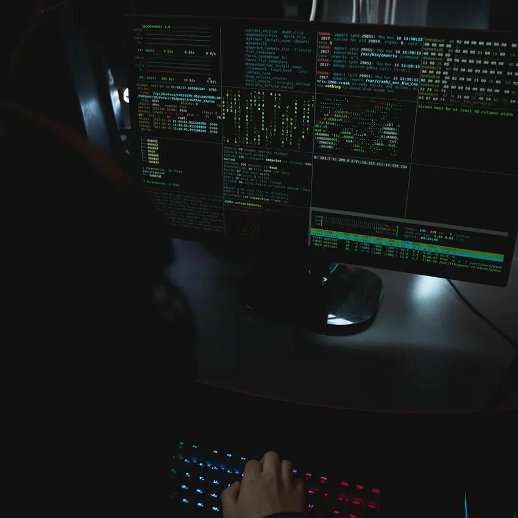

Finding a bug is fast now. Patching it is not. That gap is the whole story behind Shirudo, the open-source Linux security runtime OpenAI and Cisco launched on November 23. I have read a lot of security launches that promise to end patching. This one does something rarer: it admits it is a stopgap, and then shows its work.

Shirudo, Japanese for shield, puts a small signed protection in front of a vulnerable code path on a running Linux machine and keeps it there until the real patch is installed. No reboot, no service restart. An AI agent can write the shield. A human operator approves it before it loads. That last part matters more than the AI part, and I will come back to it.

## The gap is the vulnerability

Here is the problem Shirudo is built for. AI-assisted bug hunting has made vulnerability discovery much faster. The Register put the count at more than 100,000 software flaws reported in 2026, many of them surfaced after AI-powered finders arrived. Discovery is now machine speed. Patching is still human speed: somebody has to test the fix, find a maintenance window, and roll it out across a fleet without breaking anything.

That window between disclosure and patch is where exploits live. The standard advice, patch faster, is correct and useless at the same time, because the bottleneck was never willingness. It is testing, change control, and downtime. Shirudo attacks the window itself instead of pretending it does not exist.

The idea is not new. Compensating controls, temporary hardening that blocks one attack path without a patch, have been around for years. What is new is doing it as code, inside the kernel, at the speed the flaw was found.

## What a shield actually does

Shirudo is built on eBPF, the Linux feature that runs small verified programs at chosen points inside the kernel. A shield, called a upatch in the project's docs, is a tiny program that refuses the exact call a kernel fix would close. It attaches to a running system and blocks only the exploit's path. Legitimate requests keep flowing because the shield is aimed at one operation, not the whole service.

The demo the two companies showed is specific enough to take seriously. OpenAI's Codex wrote a shield that added validation to Java's Base64 decoding routine, attached it to an Elasticsearch instance that was already running, and blocked a Java4Shell exploit attempt while the application stayed online. Cisco's release says the tool was also tested against a recent PHP flaw with the same result. One controlled test each, designed and run by the builders, so treat the results as a proof of concept rather than a benchmark. Still, a proof of concept that blocks a real exploit class on a live service without downtime is more than a slide deck.

Shirudo is a rewrite of Tetragon, the eBPF security platform Cisco's Isovalent team open-sourced in 2022. The difference is the audience: Tetragon was built for human operators, Shirudo is built for agents. Its commands take and produce structured data, and the whole workflow is designed so an agent can drive it. Isovalent's engineers have been presenting the design since the Linux Plumbers Conference in October.

## From a flaw to a shield in seven steps

This is the part I liked most, because it is where Shirudo stops sounding like a press release and starts sounding like engineering. A shield travels a long road before it touches your kernel, and every step is checked.

It starts with an agent reproducing the vulnerability and writing a few lines of BPF C. The operator's tooling compiles it and signs the loader with an ML-DSA-87 key, which is a post-quantum signature scheme. The signed shield is packed into a `.bee` file and pushed to an OCI registry, the same kind of registry that serves container images. The target pulls it, the kernel verifies the signature against a sealed keyring before its verifier even runs, and the shield attaches at the site its signed metadata names. Then the TPM extends a measurement register with the event, so there is a hardware-backed record of exactly which shields were loaded and when. The operator can verify that evidence offline with `shirudo attest`.

Two details in that chain deserve attention. First, the registry is not trusted. It can withhold or replay packages, but it cannot produce a shield that passes the target's signature checks. Second, nothing on a target listens for connections. Targets pull shields and push telemetry out; nobody can push a shield in.

{: width="350" }
*Code on a monitor: an agent writes the shield, a human approves it (Photo: Pexels)*

## The part that impressed me: the trust model

Security tools that run inside the kernel usually ask you to trust them completely. Shirudo's design assumes you will not, and builds the checks accordingly. Enforcement starts at boot from the initrd, before the root filesystem starts other workloads. The platform guards its own runtime and state against root on the target, as long as root does not hold the operator's signing key. A shield goes live only when the evidence says it is safe, and a human approves it. That is the line Cisco and OpenAI keep repeating, and the architecture backs it up.

The TPM angle is worth a pause. I have written before about hardware roots of trust in the piece on [BitLocker's TPM-only default](/posts/bitlockers-tpm-only-default-is-the-weak-link-add-a-preboot-pin/). The idea is the same here at fleet scale: a chip keeps a tamper-evident log of what ran on the machine, so an auditor can check later whether the shield was really there. A log you cannot rewrite is the difference between a claim and evidence.

## Now the honest limits

A tool this early deserves a hard look at what it cannot do yet, and to their credit the project's own docs are blunt about it.

Shirudo is pre-release. Running it on a production target today requires a Linux kernel carrying Shirudo's out-of-tree patches and the signed-loader ABI, plus a TPM 2.0 chip. Almost nobody has that kernel. There is a VM quickstart that uses a software TPM, and that is where this belongs for now: a lab, not a fleet.

The shield coverage has holes. Isovalent engineer John Fastabend told a Linux kernel summit this year that his team often found vulnerabilities with no suitable point in the kernel where a shield could attach. Some flaws simply have nowhere to hook. And the project's documentation states plainly that a kernel bug giving an attacker code execution bypasses every check Shirudo makes, because nothing running inside the kernel can police an attacker who already controls it. That is honest, and it is also a real limit on what a shield can promise.

Then there is the question that made me pause longest. Letting an AI agent write rules that run inside your kernel is a big trust leap, and not everyone is comfortable with it. Marcus Hutchins, a principal threat researcher at Expel, has said that while eBPF has mitigation potential, letting AI agents write kernel-level rules is concerning. I agree with the worry, and I think the human approval step is the only thing that makes the design defensible. An agent drafts, a person decides. If that step ever becomes a rubber stamp, the whole model breaks.

One more practical note: Shirudo is Linux only. The macOS and Windows kernels do not expose the pieces it depends on, so do not wait for a port.

## Who should try it, and who should wait

If you run Linux infrastructure and you like kicking the tires on security tooling, clone the repo at [github.com/shirudo-dev/shirudo](https://github.com/shirudo-dev/shirudo) and run the VM quickstart. It is free, BSD 2-Clause licensed, and the repo already has more than 2,300 stars, so you will not be alone in there. Read the threat model in the docs first. It tells you exactly where the guarantees stop, which is more than most security marketing ever does.

If you run production systems and you were hoping for a deploy-today fix for your patch backlog, wait. Shirudo needs tagged releases, distro kernels, and a lot more tested shields before it belongs anywhere near production. OpenAI and Cisco are running a technical deep dive webinar on December 15, and that is a better moment to judge how fast this matures.

## My take

I am cautiously impressed, which is not a sentence I write often about an AI security launch. The impressive part is not the AI. It is the discipline: signed shields, a TPM-backed record, a human in the loop, and documentation that names its own limits instead of hiding them. The worrying part is also real. One controlled demo is not a track record, the kernel requirement keeps it in the lab, and an agent writing kernel code is exactly the kind of power that needs a skeptical operator on the other end.

Shirudo's real test will not be whether it can block one exploit in a demo. It will be whether teams publish tested shields alongside vulnerability disclosures, the way the two companies say they want, so one team's work becomes every team's starting point. If that happens, the patch gap gets a little smaller. If it does not, Shirudo stays an interesting lab project. Either way, it is the most honest answer to the patch gap I have seen this year, and that is why I am watching it.

## Frequently asked questions

**Is Shirudo ready to use on my servers?**

No. It is pre-release, and a production target needs a Linux kernel carrying Shirudo's patches plus a TPM 2.0 chip. The safe way to try it is the VM quickstart, which uses a software TPM.

**Does a Shirudo shield replace patching?**

No. A shield is a temporary mitigation that blocks one vulnerable code path while the real patch is tested and rolled out. It retires when the patch lands.

**Can an attacker with root access remove a shield?**

Not without the operator's signing key. Every load and unload goes through a signed loader the kernel verifies, and the TPM records each change. A kernel bug that gives an attacker code execution is the exception: Shirudo's own docs say that bypasses its checks.

**Does Shirudo work on macOS or Windows?**

No. It is Linux only, because it depends on eBPF, the kernel's signed BPF loader, and TPM 2.0 attestation, which the other platforms do not expose in the same way.
