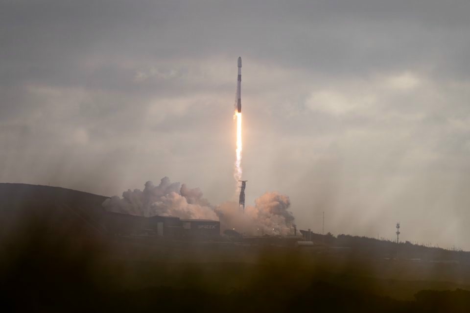
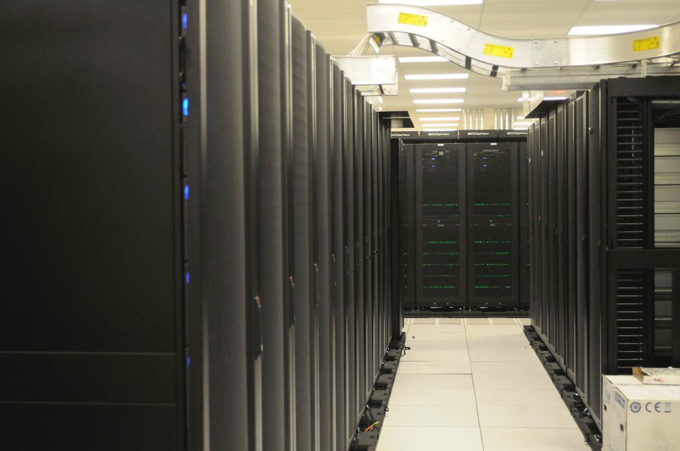

On Wednesday, the Federal Communications Commission gave SpaceX permission to deploy up to one million satellites that work as data centers in orbit. The FCC called it the first authorization in U.S. history for a constellation of data centers in space, and the headlines wrote themselves.

Here is my verdict up front: the permission is real, and it matters, but it is not what the headline makes it sound like. Nobody is launching a million data centers next year. What SpaceX actually won is a much narrower license, a 14-year deadline, and a long list of questions the FCC explicitly refused to answer yet. The interesting story is the gap between the announcement and the paperwork.

## What the FCC actually approved

The order, DA 26-1273, adopted November 25, 2026, grants SpaceX's application in part and defers it in part. That split is the whole story.

What got approved is radio spectrum for backup and emergency command links, the basic telemetry, tracking, and command channel every spacecraft needs. The bands are 18.8 to 19.3 GHz down to Earth and 28.6 to 29.1 GHz up, granted on an unprotected, non-interference basis. In plain terms, SpaceX can use those frequencies to talk to its satellites if the primary system fails, and nobody has to protect that link from interference.

The primary system is not radio at all. Starmind satellites are meant to talk to each other with optical laser links and beam their results back to Earth through the Starlink network. The radio license is the backup plan, not the product. The FCC order says so directly: Starmind will rely on optical links for communications.

That is a much smaller thing than "the FCC approved a million data centers." It is permission to operate the constellation's command channel, with conditions, and it leaves the hardest questions for later. The constellation itself is authorized for up to 1,000,000 non-geostationary satellites in shells 50 km deep, at altitudes from 500 to 1,002 km, in 30-degree and sun-synchronous inclinations. But authorization is a ceiling, not a construction schedule. SpaceX has not said it will actually build all one million.

## Why put a data center in space at all

SpaceX's pitch is simple. On the ground, the three things strangling AI data centers are power, cooling, and permission. Finding gigawatts of electricity takes years. Cooling eats a huge share of that power. And every new site fights local zoning boards and permitting battles.

SpaceX's [Starmind page](https://www.spacex.com/spacexsi/starmind) frames orbit as the answer to all three at once: "capturing solar energy in space to power low-cost, high-performance AI compute for Earth." In sun-synchronous orbit the satellites get continuous sunlight with no weather and no grid to negotiate. Heat radiates straight into the vacuum, and SpaceX claims that cuts cooling power overhead by an order of magnitude compared with chillers, cooling towers, and fans on the ground.

The hardware is not a thought experiment anymore, at least on paper. The first-generation satellite, AI1, is a 30-meter-tall spacecraft with a 75-meter wingspan, carrying a compute payload SpaceX lists at up to 250 kW peak and 175 kW average. It is built around an optimized version of Nvidia's Vera Rubin NVL72 rack-scale system. [Nvidia confirmed the partnership on August 24](https://investor.nvidia.com/news/press-release-details/2026/SpaceXAI-Adopts-NVIDIA-Vera-CPU-to-Accelerate-Agentic-AI-at-Massive-Scale/default.aspx), and Musk has targeted the fourth quarter of 2027 for the first launch, with significant scale in 2028. SpaceX is building a Gigasat Factory in Bastrop to manufacture the satellites, aiming to produce thousands starting as soon as late 2027.

{: width="350" }
*A Falcon 9 carrying 27 Starlink satellites lifts off from Vandenberg, October 23, 2026 (Photo: U.S. Space Force, Airman Enso Valle)*

None of that has flown yet, and that is worth saying out loud. As of today, no Starmind satellite exists in orbit. The whole program is a filing, a factory under construction, and a launch target about a year away.

## The 14-year clock

The FCC did not hand SpaceX an open-ended permission. The authorization comes with milestones, and missing one voids the whole thing. Here is the schedule SpaceX has to hit:

| Deadline | Requirement |
|---|---|
| November 25, 2033 | First operational satellite |
| November 25, 2035 | 100,000 satellites, 10 percent of the constellation |
| November 25, 2038 | 500,000 satellites, half the constellation |
| November 25, 2040 | All 1,000,000 satellites |

Seven years to the first satellite sounds generous until you do the math on the rest. Starlink took seven years to reach just over 11,000 satellites in orbit, and it did that with a launch cadence no other company has ever matched. Getting from one satellite in 2033 to 100,000 by 2035 means deploying roughly 50,000 satellites a year. That is the real test of this program, and it has nothing to do with the FCC. It is a manufacturing and launch problem, and Starship's fully reusable architecture is the bet SpaceX is making to solve it.

## The objections, and what got deferred

The approval came over formal objections from Amazon, satellite operator Viasat, and the American Astronomical Society. Their concerns were debris, congestion, radio interference, and environmental effects, and none of those worries went away because the FCC signed the order.

The biggest loose end is what happens to dead satellites. SpaceX asked for a waiver to move retired satellites operating above 600 km into graveyard orbits instead of bringing them down to burn up in the atmosphere. The FCC deferred that request. Before SpaceX launches anything above 600 km, it has to file a modification with a final debris mitigation plan. That is not a footnote. Most of the authorized shells sit above 600 km, since the range runs from 500 to 1,002 km.

The scale is what makes astronomers nervous. A million satellites would be roughly fifty times the number of satellites in orbit today. I have watched Starlink trains cross the sky myself, and the effect on a dark sky is already obvious with 11,000 satellites up there. Multiply that by ninety and the night sky becomes a different thing entirely.

{: width="350" }
*Starlink satellites crossing the sky over Carson National Forest, New Mexico, in a long exposure (Photo: M. Lewinsky/NOIRLab, CC BY 2.0)*

Google and Blue Origin are chasing the same idea, so this is not a one-company fantasy. But being first through the regulatory door is not the same as being first to make it work. SpaceX said as much itself in a filing ahead of its June public offering, warning that orbital data centers rely on "unproven" technologies and "may not achieve commercial viability." That is the company telling its own investors to keep their expectations in check, and I think it is the most honest sentence in this whole story.

## What it means for the internet down here

I wrote recently about [why half the internet keeps going down at the same time](/posts/why-half-the-internet-keeps-going-down-at-the-same-time/), and the pattern there was concentration: a handful of ground facilities and a few failure points taking huge chunks of the internet with them. Orbital data centers are the opposite bet. Spread the compute across a million nodes in space and no single power cut or fiber cut can take it down.

But there is a catch the orbital pitch does not advertise. Every result those satellites compute still has to come back to Earth, and the way down is Starlink. We are not replacing terrestrial infrastructure. We are adding a very expensive, very distant layer on top of it, and that layer only works if the ground stations, the laser links, and the Starlink mesh all hold up.

{: width="350" }
*Server racks in a data center on the ground (Photo: NERSC, CC0)*

That is why I think the right way to read this news is as a starting gun, not a finish line. The FCC removed one obstacle, and it was a real one. A million-satellite constellation with no radio license is a non-starter. But the obstacles that remain, building a million AI satellites, launching them, keeping them from colliding, cooling them, and doing it all at a price that beats a warehouse in Virginia, are bigger than the one that just fell.

## My take

I am genuinely excited by this, and I am also skeptical, and I do not think those two things contradict each other. The physics pitch is sound. Free solar power, free cooling, no neighbors to complain. If anyone can build the launch cadence this needs, it is the company that already flies most of the world's rockets.

But I have covered enough ambitious infrastructure to know that the gap between a regulatory win and a working system is where most big ideas go to die. The FCC gave SpaceX until 2040 to put a million machines in orbit. The first real deadline is much sooner: a working AI1 satellite, in space, doing actual compute, by late 2027. Until that flies, Starmind is a very good slide deck with a very expensive factory attached.

Watch the first launch, not the license. The license was the easy part.

## Frequently asked questions

**Did the FCC really approve a million satellites?**

Yes, up to one million, but the grant is narrower than the headline. It authorizes backup radio links for the Starmind constellation, not a million launches tomorrow, and it comes with firm deployment deadlines.

**When will the first Starmind satellite launch?**

Elon Musk has targeted the fourth quarter of 2027 for the first launch, with significant scale in 2028. SpaceX CFO Bret Johnsen said the company plans to put its first data centers in space in 2027 and expand through 2029.

**What happens if SpaceX misses the deadlines?**

The authorization goes void. SpaceX must have one satellite operating by November 2033, 100,000 by November 2035, 500,000 by November 2038, and the full million by November 2040.

**Will a million satellites ruin the night sky?**

Astronomers are worried, and they objected. The American Astronomical Society raised debris, congestion, and interference concerns. The FCC deferred the decision on disposing of satellites above 600 km, and SpaceX must file a final debris plan before launching there.
