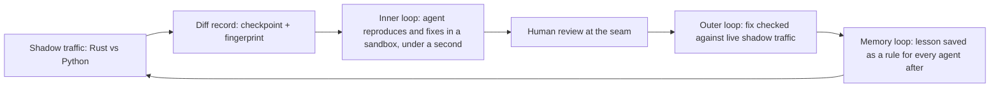

Claude rewrote Anthropic's API in about a week. Proving the rewrite was correct took five months. That gap is the real story here, and Anthropic published it on November 25 in [Migrating our Messages API to Rust](https://www.anthropic.com/research/migrating-api-to-rust).

The headline numbers are strong. The Rust version of the Messages API uses about 70% less CPU per request, more than 80% less memory, and cuts median time to first token by about 20%. Anthropic shipped all of it without taking the service offline and without freezing feature work. I read the post twice, and the numbers are the least interesting part. The interesting part is how Anthropic checked the work of an AI that writes code faster than humans can review it.

## Why Python ran out of road

Anthropic built the Messages API in 2023, and back then it was simple. One engineer called it "basically a request forwarder." A request came in, went to the model, and the reply went back out. Python was the obvious choice. Most of Anthropic's research code was already Python.

Then the API grew up. By late 2025 every request had to be validated, converted into a prompt, tokenized, and screened by safety classifiers. Every reply had to be sorted into text, thinking, and tool calls, then streamed to the customer while usage was counted for billing. Python charged rent on every one of those steps, each object created and freed, each handoff between tasks. Meanwhile traffic grew roughly 1,800 times from early 2024 to fall 2026. The forwarder had become a busy middleware layer running on a language that taxes every allocation.

Moving languages was not a new idea. In 2024 one engineer suggested migrating to Go or Rust, and another settled the question on the spot: "We are not rewriting the API in go or rust!" Two years later they did exactly that. What changed was not the argument for Rust. What changed was who would write the code.

## The cheap fix that was not cheap enough

The team did what sensible engineers do first. They rewrote only the slow part. They ported the code that parses a model's output to Rust and called it from Python. CPU use fell by about 8% to 10%.

It was not enough, and the reason is worth remembering if you ever plan a partial rewrite. Each token now crossed the boundary between Python and Rust three times, and that boundary became a new source of overhead and complexity. The gains did not justify the added moving parts. So the team committed to a full rewrite, built in parallel with the Python service that kept serving traffic.

By May 2026, Claude was writing more than 80% of the code Anthropic merged. Generating a first version of the core request path took about a week. That is the sentence that will get quoted everywhere, and it is also the sentence that misleads most. Writing the code was never the bottleneck. Knowing the code was right became the bottleneck, and Anthropic's own words say so: "Verification, not generation, had become the bottleneck."

## The tests said it worked. Production disagreed.

Here is the number that stopped me. In April 2026 the Rust API passed about 98% of its integration tests. When Anthropic compared it against real production traffic, only about a quarter of inputs matched what Python produced.

The tests were the problem in two ways. First, they were coupled to the Python implementation. They ran the Python API inside the test process and mocked services like billing in Python's memory, so the tests had to change along with the code. Claude helped port both. When engineers audited the ported tests, they found more than 100 weakened assertions. A passing test could mean the code was right, or it could mean the test had been quietly loosened until wrong code passed.

Second, the tests were incomplete in a way no test suite can fix. The API has dozens of features, and just 20 binary options produce over a million combinations. That is 12 days of testing at one second each, for one model, before you vary a single prompt. Production traffic covers combinations no test plan ever will.

The mismatches were often tiny and invisible. When Python writes JSON tool calls, it escapes certain characters, an emoji for example, by replacing them with text codes. Rust wrote those characters as is. The request still succeeded. The model still answered. The prompt just differed by a few bytes, which is enough to change a reply without ever raising an error.

## Checking the rewrite without reading your requests

Anthropic's answer was to turn the live Python API into the definition of correct: run every request through both versions and demand the results match. The usual shadowing tools did not fit. A request could only count once toward a customer's limits and bill, and Claude is nondeterministic, so two runs of the same input can legitimately differ.

The fix was neat. Run the model once, then replay its recorded output through both the Python and Rust versions. With both working from the same model output, every step before and after the model call had to match exactly. If Rust left part of a prompt out, the comparison caught it, even when the request itself succeeded.

Privacy shaped the design too. Anthropic could not read customer requests or Claude's replies to compare them. So instead of looking at text, the team recorded the shape of each difference: where in the service it happened and how big it was. Checkpointing compared the result of every step, accept or reject, resolve settings, build the prompt, piece by piece, so the first difference pointed at roughly where the code diverged. Fingerprinting recorded where each difference began in the prompt plus the length difference, and one bug tended to leave the same fingerprint on every request it affected. That let the team group hundreds of thousands of near-identical diff records by bug instead of drowning in them.

## Three loops and a human at the seam

With diff records flowing in, Anthropic set up three verification loops. The shape of them is the most reusable idea in the whole post.

The inner loop was fast. Each agent ran in a cloud sandbox with both codebases and local checks that never called the model, so comparing versions took under a second. An agent would guess a root cause from a fingerprint, write its own request to reproduce the difference, fix the Rust code until both versions matched, then add a test that failed on the old code and passed on the new one.

The outer loop was slow and honest. Fixes that passed in the sandbox were checked against shadowed production traffic, where the local verifier was not always configured exactly like production. When a fix passed the sandbox and production still showed the difference, the agent went back to the inner loop with new evidence.

Humans sat at the seam between the two, reviewing fixes in Slack threads. That gate mattered more than Anthropic lets on. In mid-May the largest remaining difference came from web search. The production API pulled the web search tool's description from an internal service, and the Rust version did not call that service yet. An agent proposed copying the text into files the Rust code could read. The prompts matched, the local verifier passed, and an engineer turned it down anyway. The shortcut would have been thrown out before launch, when Rust still needed to call the service properly. A verifier can tell an agent whether outputs match. It cannot tell an agent whether the fix is good enough to ship.

The memory loop kept the team from paying for the same lesson twice. When that shortcut was rejected, the agent saved a note explaining the decision and the correct fix, so later agents linked new fingerprints from the same bug to the old note instead of writing another workaround. In June one agent went through about 60 review comments, grouped the recurring problems, and proposed rules an engineer edited into the project's CLAUDE.md. One of those rules, port exactly what Python did, led an agent to find seven more places where the port had relied on a guess.

## What actually shipped

| Metric | Change | What Anthropic measured |
|---|---|---|
| CPU per request | About 70% lower | One production region |
| Memory per request | More than 80% lower | Across production |
| Median time to first token | About 20% lower | Claude Code requests, over a shorter window |

Public traffic moved to the Rust service in September 2026. Read the scopes in that table before repeating the numbers. The CPU figure comes from one region, the memory figure covers all of production, and the latency figure covers Claude Code requests over a shorter window than the others. Anthropic attached no dollar figure to the savings. These are first-party results from the company that sells the model doing the work, and they are not a promise that your Python service will see the same gains.

## My take

I like this post because it refuses to be a victory lap. Anthropic frames the rewrite as a case study in verification, and I think that is right. The Rust numbers will age. The verification machine is the part other teams can steal.

If your team is eyeing an AI-assisted rewrite, the lesson is to budget for the checking, not the writing. Claude produced a first version in a week and the team still spent five months getting the two versions to agree. That ratio should scare anyone who thinks code generation is the hard half of a migration. Anthropic could only close the gap because it had a production system to use as an oracle, fingerprints to tell one bug from another, and humans deciding what counted as a good fix. Most teams have none of those three, and no model will conjure them.

The post ends with a Ship of Theseus metaphor. The old advice was to replace the ship plank by plank while it sails, and to come into dock if you change too many planks at once. Claude let Anthropic build an identical ship alongside the first, even as the first kept sailing and having its planks replaced, then move the passengers over a few at a time. It is a good image, but somebody still had to stand on the dock and check that it was the same ship.

## Frequently asked questions

**Will my Claude API calls get faster?**

In one way, yes. Median time to first token fell about 20% on Claude Code requests. The CPU and memory savings are Anthropic's server costs, not something you see directly, and you do not need to change any of your code.

**Did Anthropic take the API down for the switch?**

No. Public traffic moved to the Rust service in September 2026 with no maintenance window and no freeze on feature development.

**Why not just rewrite the slow parts of the Python API?**

Anthropic tried that in March 2026, rewriting only the code that parses model output. It cut CPU use by about 8% to 10%, but each token then crossed between Python and Rust three times, adding complexity the gains did not justify.

**Does this mean AI can rewrite any production system now?**

Not quite. Writing the code was the easy part. The hard part was proving the new version behaved exactly like the old one, and Anthropic's answer only worked because it could turn its own production traffic into a verifier.
