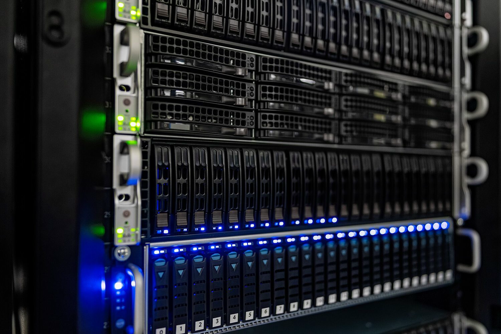
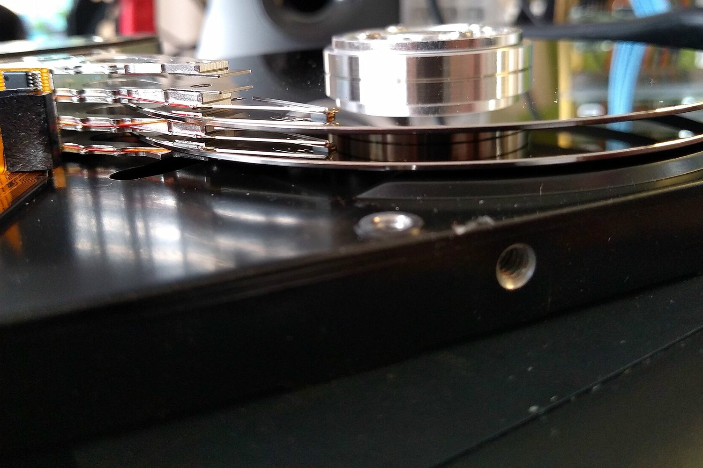

Hard drives were the last refuge. When RAM prices exploded and SSDs tripled, the humble spinning disk was still there, still cheap, still the obvious answer for anyone with terabytes to store. I kept telling people exactly that. Buy the big slow drive, spend the savings on the fast one. That advice is dead now.

A 24TB Seagate BarraCuda that sold for $239 to $249 in 2025 was listed at $499 by January 2026. ComputerBase tracked a dozen popular drives and found retail prices up 46 percent in four months. By November, its tracking put German retail HDD prices 151 percent above September 2025 levels. The surge did not stop at consumer drives. Enterprise 30TB hard drives went from $495 in the third quarter of 2025 to $1,216 a year later, a rise of about 146 percent. Even the used market repriced: a manufacturer-recertified 24TB Seagate Exos that sat in stock at $298.99 a year ago hit $699 in August, and then went out of stock anyway.

So no, you are not imagining it, and no, waiting for a sale will not fix it. This is a shortage, and sales do not fix shortages.

## The damage, in one table

Prices checked November 20 to 28, 2026. Street prices move daily, so treat these as a snapshot of a fast-moving market, not a quote.

| Drive | Before | Now | The gap |
| --- | --- | --- | --- |
| Seagate BarraCuda 24TB | $239 to $249 (2025) | $499 | About double |
| Seagate IronWolf 8TB | About $130 | $199 to $330 | 50% to 150% over |
| WD Red Pro 8TB | $189.99 (Jul 2024) | $399.99 | About double |
| Recertified Seagate Exos 24TB | $298.99 | $699, then out of stock | Up 134% |
| Enterprise 30TB HDD | $495 (Q3 2025) | $1,216 (Q3 2026) | Up 146% |

Two things stand out. First, the cheapest way to store a terabyte has roughly doubled in a year, from the $12 to $16 per TB that recertified enterprise drives used to trade at to $24 to $31, and new high-capacity drives now sit around $33 per TB at best. Second, the numbers at the top of the table are not the exception. They are the market. [A live Amazon price index](https://ratiodb.com/guides/hard-drive-prices/) puts the median hard drive at $31.22 per TB in late November, and it has barely moved in 90 days. Prices are not spiking anymore. They have settled, high.

If you want the full picture, this is the third leg of the same crisis. [We covered the GPU and RAM side two days ago](/posts/dont-wait-for-black-friday-gpu-ram-crisis/), and the pattern rhymes: AI demand ate the supply, and the manufacturers are in no hurry to build their way out.

## AI bought the production line

The mechanism is not complicated, and the manufacturers say it themselves. AI data centers generate and keep data at a rate that turned the big nearline hard drive, the high-capacity 7,200 rpm workhorse that holds the cold and warm layers of every storage pyramid, into a strategic commodity.

Seagate shipped 165 exabytes into the data center market in its December 2025 quarter, up 31 percent year over year. Data centers now take roughly 90 percent of Seagate's exabyte shipments. On the January earnings call, Seagate CEO Dave Mosley said nearline capacity was fully allocated through 2026. By the July call, that had become the vast majority of nearline exabytes allocated into 2028. Western Digital CEO Irving Tan said the same week in January that his company was pretty much sold out for calendar 2026, with firm purchase orders from its top seven customers and long-term agreements stretching into 2027 and 2028.

{: width="350" }
*Server racks at the NOIRLab headquarters computer room. Data centers now take the overwhelming share of new high-capacity drives. (Photo: NOIRLab, CC BY 4.0, via Wikimedia Commons)*

Read that again: sold out through 2028. Not a quarter. Not a product line. The production of the only two companies that make hard drives at scale, booked years ahead, by customers who sign multi-year deals and pay whatever it takes. TrendForce measured lead times for large data center drives stretching from a few weeks to over 52 weeks back in September 2025, and they never came back down.

There are only three hard drive makers left, and the third, Toshiba, is a rounding error next to Seagate and Western Digital. When two companies control a market and both are sold out, there is no competitor waiting to undercut them. That is the whole story, and it is why this surge looks nothing like the last one.

## This is not 2011

The last time hard drive prices exploded, in October 2011, floods in Thailand submerged factories responsible for nearly half of worldwide production. Prices nearly tripled overnight. A 3TB Barracuda XT jumped 138 percent, from $179.99 to $429.99. It was brutal, and it was temporary. Western Digital resumed production within 46 days, and prices drifted back down over the following year.

This time there is no flood to recover from. Nobody's factory is underwater. The factories are running at full utilization and still cannot keep up, because demand is growing 40 to 50 percent a year against supply growth of 30 to 35 percent, on Morgan Stanley's model. The industry is not rebuilding after a disaster. It is rationing a product it cannot make fast enough, and charging more for the privilege.

Seagate's chief commercial officer, Ban-Seng Teh, said it out loud this month: price hikes have become the new normal, in a supercycle driven by AI data center demand. Annual storage demand growth, which his team expected to stay under 20 percent five years ago, is instead running in the mid-20s. When a manufacturer tells you the high prices are the new normal, believe them. They are the ones setting the prices.

There is a second squeeze on top of the first, and it is stranger. High-capacity drives are filled with helium, not air, because helium lets the platters spin with less drag and less power. Qatar supplies roughly a third of the world's helium, and its Ras Laffan industrial complex was severely damaged in March 2026. Russia imposed helium export controls the following month. Spot helium prices have roughly tripled since the start of the year, and the US Department of Energy designated helium a critical material in October. Helium is not the main cause of expensive hard drives, but it is a real cost on every big drive, and it is not getting cheaper.

## When does it end?

Later than you would like. TrendForce expects HDD supply to fall about 9 percent short of demand in 2027, with the market only approaching balance in 2028, when supply growth of around 28 percent should finally outpace demand growth of around 16 percent. The relief valve is bigger drives: Seagate is already shipping 44TB HAMR drives to hyperscale customers, with 50TB models scheduled for 2028, and Western Digital is moving 40TB-class drives into mass production. More terabytes per drive means fewer drives per exabyte, which is the only kind of capacity increase that actually helps.

SSDs should ease sooner. TrendForce forecast in November that NAND flash contract prices will fall 0 to 5 percent per quarter in the first half of 2027. But that does not rescue the hard drive buyer. SSDs are still several times the price per terabyte, and nobody is backing up a media library to flash at these prices.

The knock-on effect worth watching is your cloud bill. When storage hardware doubles in price, the services that rent you storage eventually pass it on. One cloud storage provider expects 5 to 15 percent increases across many plans while the shortage lasts. If you pay monthly for cloud backup or a media server, check your renewal price before it renews.

## What to do if you need storage now

I am not going to tell you to panic-buy. I am going to tell you to stop waiting, because waiting is the expensive choice here. Every signal points the same way: allocated through 2028, no new factories coming online fast, and the manufacturers themselves calling this the new normal. Here is how I would spend the money.

Buy the capacity you need now, not the capacity you might need next year. A drive you buy today at $33 per TB beats a drive you buy next year at the same price, and the price is not going back to $15 per TB. But do not stockpile either. Drives age on the shelf, warranties tick from the purchase date, and a drive you do not need yet is money sitting in a drawer.

Compare dollars per terabyte, not sticker prices. In late November, [an 8TB price index tracking Newegg listings](https://techfuelhq.com/articles/hdd-price-crisis-2026/) put the median at $45.31 per TB, with the Seagate IronWolf 8TB at $329.99, or $41.25 per TB, against $51.87 for a WD Gold 8TB. The best value on a new high-capacity drive was around $33 per TB on a 24TB Exos. The bigger drive is usually the cheaper terabyte, which is the opposite of how it worked two years ago, when small drives were the bargain.

{: width="350" }
*Inside a 3.5-inch drive: platters, actuator arms, and a spindle motor, all of which now cost more to build. (Photo: Gwolf, CC BY-SA 4.0, via Wikimedia Commons)*

For a NAS, buy CMR, not SMR. Check the spec sheet before you pay, because some budget drives quietly use shingled magnetic recording, which is slow at rewriting data and a bad fit for RAID. Seagate IronWolf and WD Red Plus are the safe CMR picks in the NAS aisle. And if you are replacing a dead drive in an existing array, match the capacity and buy it now. A degraded RAID array is a gamble you do not want to hold while prices climb.

Recertified enterprise drives look tempting at $27 to $30 per TB, and sometimes they are fine. Sometimes they are pulls with tens of thousands of power-on hours and a warranty that only exists if you read the fine print. [The same channel that sold a recertified 24TB Exos for $298.99 a year ago](https://pcserverandparts.com/news/hard-drive-shortage-2026-what-to-do/) was asking $699 by August, and then it was gone. If you go this route, verify the warranty channel, check the SMART data the day it arrives, and never put a recertified drive in as the only copy of anything.

One more thing, and it is the least fun piece of advice in this article: if you have been meaning to back up the things that matter, do it this weekend. Not because drives will be gone on Monday, but because the cheapest day to buy storage in this market was yesterday, and the second cheapest is today. That was true in September, it is true now, and every forecast says it will still be true next year.

## Frequently asked questions

**How much have hard drive prices gone up in 2026?**

About 50 percent year over year on average, and much more on the big drives. A 24TB Seagate BarraCuda that sold for $239 to $249 in 2025 was listed at $499 by January 2026, and a recertified 24TB Seagate Exos went from $298.99 to $699 in about a year. Enterprise 30TB drives rose 146 percent in a year, from $495 to $1,216.

**Why are hard drives so expensive now?**

AI data centers bought the production line. Seagate says most of its high-capacity nearline output is allocated through 2028, and Western Digital says it is sold out for 2026 with long-term deals running into 2028. A helium shortage from the March 2026 damage at Qatar's Ras Laffan plant and Russian export controls is squeezing manufacturing on top of that.

**Will hard drive prices come back down?**

Not soon. TrendForce expects HDD supply to run about 9 percent short of demand in 2027, with the market only approaching balance in 2028. Seagate's own commercial chief calls the higher prices the new normal. If you need storage, waiting for a return to 2024 prices is a long bet.

**What should I buy if I need storage now?**

Buy the capacity you actually need now, and compare dollars per terabyte before you buy anything. In late November 2026 the best value on a new high-capacity drive was around $33 per TB on a 24TB Seagate Exos, while 8TB NAS drives ran $41 to $52 per TB. For a NAS, stick to CMR drives, and treat cheap recertified enterprise pulls as a gamble, not a deal.
