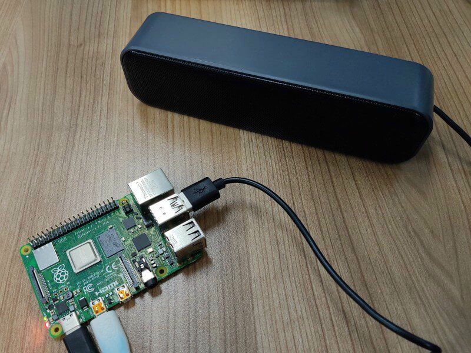
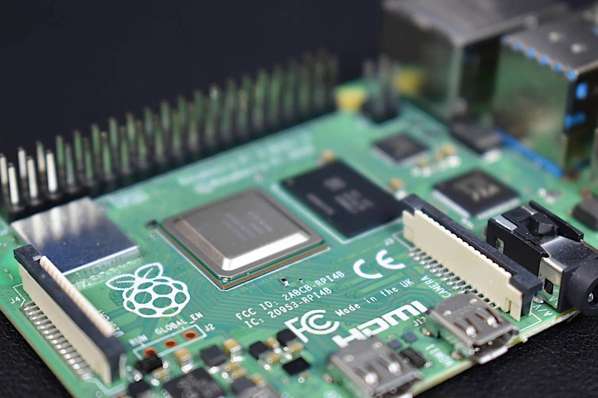

Apple will never sell you a cheap AirPlay speaker. The cheapest official AirPlay 2 endpoint is a HomePod mini, and Apple would rather you buy one per room than put its protocol on your old stereo. A Raspberry Pi does the job for the price of a pizza, and it does it well enough that I would rather spend the money on speakers than on the receiver.

The tool is shairport-sync, an open source AirPlay audio player maintained since 2014. The current 5.6 series, released in October 2026, plays AirPlay 2 audio including lossless 24-bit stereo at 48,000 frames per second, and it can join multi-room groups alongside real HomePods. Your iPhone sees the Pi in the AirPlay picker exactly like a product Apple made. It just costs a tenth as much, and it plugs into speakers Apple has never heard of.

That is the pitch. Here is the honest version: this works because a small group of people reverse-engineered a protocol Apple never published, and Apple could break it with an iOS update any year. It has not happened yet in over a decade of shairport-sync, and the project has 9,000 stars on GitHub for a reason. Go in knowing what you are building. This is a weekend project with a maintenance tail, not a gadget you unbox and forget.

## What you need

A Raspberry Pi, any model from the original B onward, though I would not start below a 3B+ for a room you actually listen in. A microSD card, 8 GB or more. A power supply that matches the board. And something to make sound: the 3.5mm jack on a Pi 3 or 4, an HDMI cable into a receiver, or a USB DAC. The Pi 5 dropped the analog jack entirely, so if that is your board, budget for a USB DAC or an I2S DAC board that sits on the GPIO header.

Flash Raspberry Pi OS Lite (64-bit) with Raspberry Pi Imager. The Lite image skips the desktop, which is exactly what you want for a box whose only job is playing music. Set the hostname, username, password, Wi-Fi, and SSH in the Imager's customization screen before you write the card, then boot the Pi and SSH in. No monitor needed, no keyboard needed.

{: width="350" }
*A Pi and a USB speaker are the whole hardware list. (Photo: PiShop)*

Before you install anything, prove the Pi can make noise. Run `aplay -l` to list audio devices, then `speaker-test -D plughw:Headphones -c2 -t wav` and listen for the hiss. If you hear nothing, the problem is the cable or the output device, and it is much easier to find that out now than after you have compiled two projects. On a Pi 4 the jack shows up as `Headphones`; on a Pi 5 with a USB DAC it will be whatever `aplay -l` calls your DAC.

## The one decision: package or source

There is a `shairport-sync` package in Debian's repositories, and `sudo apt install shairport-sync` will finish in seconds. That is the trap. The packaged version may be older than the current release and may not have AirPlay 2 support compiled in. If all you want is classic AirPlay from one phone to one speaker, the package is fine. If you want multi-room audio, or the Pi to sit in a group with a HomePod, you need AirPlay 2, and that means building from source. It is two projects and about fifteen minutes of compiling on a Pi 4, using the projects' own instructions below.

## Build nqptp first

AirPlay 2 needs precise timing so every speaker in a group plays the same sample at the same moment. Apple moved that timing to PTP, the Precision Time Protocol, and shairport-sync's author split it out into a small companion daemon called nqptp. It is a separate build and a separate service, and it is the piece most guides rush past. Without it, AirPlay 2 simply does not work. Install the build dependencies first:

```
sudo apt update && sudo apt full-upgrade -y
sudo apt install --no-install-recommends build-essential git autoconf automake libtool \
  libpopt-dev libconfig-dev libasound2-dev avahi-daemon libavahi-client-dev libssl-dev libsoxr-dev \
  libplist-dev libsodium-dev uuid-dev libgcrypt-dev xxd libplist-utils \
  libavutil-dev libavcodec-dev libavformat-dev
```

One wrinkle if you are on Debian 13 (Trixie) or newer, which is what current Raspberry Pi OS is based on: you also need `systemd-dev`, or neither service will start at boot. Install it with `sudo apt install --no-install-recommends systemd-dev` before going further.

Then build nqptp:

```
cd ~
git clone https://github.com/mikebrady/nqptp.git
cd nqptp
autoreconf -fi
./configure --with-systemd-startup
make
sudo make install
sudo systemctl enable --now nqptp
```

nqptp needs exclusive access to UDP ports 319 and 320, the PTP ports. If you run another service that wants those ports, nqptp will fail to start and AirPlay 2 sync will silently not work. Check `sudo systemctl status nqptp` shows active before moving on.

## Build shairport-sync

Now the main event, same pattern:

```
cd ~
git clone https://github.com/mikebrady/shairport-sync.git
cd shairport-sync
autoreconf -fi
./configure --sysconfdir=/etc --with-alsa \
  --with-soxr --with-avahi --with-ssl=openssl --with-systemd --with-airplay-2
make
sudo make install
```

The flags that matter are `--with-alsa` for the audio backend, `--with-avahi` so the Pi announces itself on your network, `--with-soxr` for high-quality resampling, and `--with-airplay-2`, which is the whole point. When `make` finishes, run `shairport-sync -V` and look for `AirPlay-2` in the feature string. If it is not there, the build missed a dependency and you built the classic version by accident. Do not skip this check; it is a thirty-second test that saves a very confusing evening.

{: width="350" }
*A Pi 4 is the sweet spot for this build: enough power for resampling, cheap enough to leave running. (Photo: MakersPortal)*

## Name it and point it at your speakers

Open the config file with `sudo nano /etc/shairport-sync.conf`. Two settings do most of the work. In the `general` section, set the name your phone will see:

```
general =
{
  name = "Living Room";
};
```

In the `alsa` section, set the output device you proved works earlier:

```
alsa =
{
  output_device = "plughw:Headphones";
};
```

Swap `plughw:Headphones` for your DAC's name from `aplay -l` if you are not using the jack. Save, then enable the service and start it:

```
sudo systemctl enable --now shairport-sync
```

Within a minute, "Living Room" should appear in the AirPlay picker on any iPhone, iPad, or Mac on the same network. Tap it, press play, and your dumb speakers are smart. If it does not appear, check both services are running with `sudo systemctl status nqptp shairport-sync`, and confirm your phone and the Pi are on the same network. AirPlay discovery runs over mDNS, and a guest network or VLAN between the two will hide the Pi completely.

## What it cannot do

Audio only, always. Shairport-sync cannot receive AirPlay video or photo streaming, so your Pi will never be a screen mirroring target. That is a hard limit of the project, not a setting you missed.

Latency is real and it is by design. Classic AirPlay sources ask for about two seconds of delay between the sample's timestamp and the moment it reaches your ears. AirPlay 2 cuts that to around half a second. Either way, this is not a speaker for watching video. The sound will lag the picture on your TV, and no setting fixes that. For music and multi-room audio, the delay is invisible. For a home theater, buy something else.

And the fragility I mentioned up front: the protocols were never published by Apple. Shairport-sync exists because people studied them and reimplemented them. An iOS update could change the handshake tomorrow and the project would need a patch. Version 5.6 also added remote control for AirPlay 2 players, which shows the project is still moving, but I would not build a business on it.

## My take

I like this project for what it is: the cheapest honest way to put AirPlay on speakers you already own. A HomePod mini is a fine speaker, but it is a bad answer to the question "how do I play music on the stereo I already like." A Pi, a cable, and two open source projects answer that question for a fraction of the price, and the multi-room sync genuinely works.

The build-from-source step scares people off, and I get it. But the compile is fifteen minutes of waiting, not fifteen minutes of thinking. The thinking is the two decisions in this article: build from source instead of taking the package, and build nqptp first instead of wondering later why AirPlay 2 will not sync. Get those right and the rest is typing.

## Frequently asked questions

**Does this work with AirPlay 2 or only the original AirPlay?**

Both, if you build shairport-sync from source with the --with-airplay-2 flag and install its timing companion nqptp. The version in Debian's package repository may not have AirPlay 2 support enabled, so check with shairport-sync -V and look for AirPlay-2 in the feature list.

**Can I play video or mirror my screen to the Pi?**

No. Shairport-sync is audio only. It cannot receive AirPlay video or photo streaming, and it will never show up as a screen mirroring target.

**Which Raspberry Pi do I need?**

Anything from a Pi B onward will run it, according to the project's own docs, and a Pi 3B+ is enough for a single room. A Pi 4 or 5 gives you more headroom and fewer dropouts, and note the Pi 5 has no 3.5mm audio jack, so you will need a USB DAC or an I2S DAC board with that model.

**Will an iOS update break it?**

It can. AirPlay is a reverse-engineered protocol that Apple never published, so a future iOS or tvOS release could change the handshake and leave you waiting for a shairport-sync update. It has kept working through years of updates so far, but treat it as a hobby project, not infrastructure.
